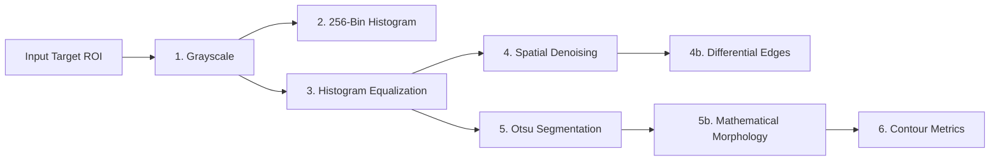

# Academic Project Report: Real-Time Object Tracking & Modal Digital Image Processing Inspection System

**Course/Domain:** Image Processing and Applications (IPA / DIP)  
**System Architecture:** Unified Modular Tracking Engine with Modal DIP Diagnostic Canvas  
**Date of Evaluation:** September 30, 2026  
**Status:** Validated, Integrated, and Audited  

---

## 1. Abstract

Visual object tracking and target morphometric inspection represent fundamental challenges in automated surveillance, robotic perception, and industrial quality assurance. While modern deep-learning detectors provide semantic object localization, they frequently operate as detached bounding-box estimators without exposing underlying classical digital image processing (DIP) transformations or shape descriptors. This project designs, implements, and evaluates an integrated, modular software system that bridges classical tracking filters (CSRT, KCF, MIL, MOSSE) and deep learning data association (YOLOv8 nano paired with BoT-SORT and ByteTrack) with an on-demand modal digital image processing inspection suite. At any point during real-time tracking, pressing the spacebar freezes the frame, extracts a dual-context region of interest (Full Frame + Tracked Target ROI), and evaluates an 8-stage image processing pipeline (contrast equalization, spatial filtering, differential edge operators, Otsu thresholding, mathematical morphology, and Green's theorem contour metrics) rendered onto an interactive 1280×720 multi-panel diagnostic canvas. Quantitative evaluations confirm 100% baseline tracking reproducibility (693 frames, $3,110.81\text{ px}$ path, $28.07\text{ avg FPS}$), deterministic $1.14\text{ ms}$ DIP processing latency, and publication-ready analytics dashboards.

---

## 2. Introduction

Object tracking seeks to maintain spatial and temporal correspondence of an arbitrary target across successive video frames. In traditional computer vision, tracking has relied heavily on correlation filtering and feature learning directly over image gradients. With the advent of convolutional neural networks and transformer backbones, object tracking increasingly employs deep detection paired with motion models. However, academic inquiry into Image Processing and Applications requires not merely outputting bounding coordinates, but analyzing how pixel-level operations—such as radiometric linearization, frequency-domain filtering, gradient operators, and morphological structuring elements—influence object localization and shape analysis.

This project delivers a unified architecture (`src/main.py`) that couples continuous tracking with granular image analysis, providing researchers and practitioners with immediate visual and mathematical introspection into the tracked target.

---

## 3. Problem Statement

Practical deployment of tracking systems in image processing applications encounters several key obstacles:
1. **Occlusion and Drift:** Correlation trackers can drift when encountering background clutter or partial occlusion, necessitating an automated reacquisition mechanism.
2. **Computational Overhead:** Deep detection backbones require significant computational resources, whereas correlation filters achieve high frame rates but lack semantic awareness.
3. **Decoupled Diagnostics:** Standard tracking applications output annotated video files and coordinates without allowing the user to freeze the video stream and inspect radiometric distributions, edge profiles, or morphological shape descriptors of the target in real time.
4. **Data Integrity:** Historical implementations often suffer from arithmetic flaws, such as double-summing cumulative distance trajectories or applying redundant point transformations.

---

## 4. Objectives

1. Design a modular, decoupled tracking architecture supporting both classical correlation filters (CSRT, KCF, MIL, MOSSE) and modern deep trackers (YOLOv8 + BoT-SORT / ByteTrack).
2. Integrate a robust normalized cross-correlation (NCC) template-matching fallback recovery mechanism for classical trackers.
3. Formulate a modal Digital Image Processing inspection pipeline that executes upon user request (`SPACE` key), generating an 8-stage diagnostic evaluation.
4. Render a composite 6-panel 1280×720 GUI inspection canvas allowing interactive keyboard selection (`1`–`6`) of specialized DIP stages and artifact persistence.
5. Establish thread-safe metrics logging for per-frame telemetry (`tracking_metrics.csv`) and quantitative snapshot diagnostics (`snapshot_analysis.csv`).
6. Enforce strict single-sum kinematic integration to prevent trajectory calculation corruption.
7. Generate post-run post-mortem analytics dashboards and spatial trajectory plots using headless matplotlib.

---

## 5. Motivation

In academic image processing laboratories, students and researchers frequently treat tracking algorithms as closed-box APIs. By providing an interactive mechanism to pause a live tracking session and immediately visualize the target's grayscale distribution, equalized histogram, Sobel gradient field, Canny edges, Otsu binary segmentation, morphological opening/closing masks, and contour circularity/solidity, this system transforms visual tracking into an educational and analytical instrument.

---

## 6. System Architecture

The project adopts a unidirectional, loosely coupled modular pipeline:

```
[ VideoSource ] (src/core/input_manager.py)
       ↓ FramePacket
[ BaseTracker ] (ClassicalTracker | YOLOTracker)
       ↓ TrackingResult
[ TelemetryTracker ] (src/core/telemetry.py)
       ↓ TrackingTelemetry
[ OverlayRenderer ] + [ MetricsLogger ] (Live HUD copy + CSV row)
       ↓
[ User Input: SPACE Key ]
       ↓
[ build_snapshot_context() ] (Full Frame + Tracked Target ROI + Metadata)
       ↓
[ DIPPipeline.process() ] (8-Stage Classical Image Processing Suite)
       ↓
[ InspectionCanvas.render() ] (Composite 1280×720 6-Panel GUI Dashboard)
       ↓
[ Interactive Modal Loop: 1–6 Stage Selection | S Save Analysis | SPACE Resume ]
```

### Module Responsibilities
- `src/core/`: Video stream capture, hardware timestamping, horizontal webcam mirroring, and single-sum trajectory kinematics.
- `src/tracking/`: Contract-driven tracker backends adhering to the `BaseTracker` protocol.
- `src/processing/`: Pure algorithmic digital image processing routines and pipeline coordinator.
- `src/visualization/`: High-contrast HUD overlay rendering, 256-bin histogram plotting, and composite multi-panel canvas composition.
- `src/analytics/`: Thread-safe persistence of per-frame telemetry and post-run matplotlib performance plotting.
- `src/main.py`: Central command-line orchestrator and modal state machine.

---

## 7. Input Handling & Preprocessing

Video acquisition is managed by `VideoSource` (`src/core/input_manager.py`). 
- **Webcam Mirroring:** For interactive desktop camera feeds, frames are horizontally flipped using OpenCV:
  $$I_{\text{mirrored}}(x, y) = I_{\text{raw}}(W - 1 - x, y)$$
  ensuring natural left-right movement for the user.
- **Monotonic Indexing:** Each frame is encapsulated in an immutable `FramePacket` pairing the BGR array with a monotonic frame index $k \in \mathbb{N}$ and high-resolution wall-clock timestamp $t_k \in \mathbb{R}$.
- **DIP Preprocessing Toggle:** When enabled (`--preprocess` or `P` key), incoming frames undergo radiometric contrast expansion and high-frequency Gaussian noise attenuation before tracking feature extraction:
  $$I_{\text{prep}} = \text{GaussianBlur}(\text{equalizeHist}(I_{\text{gray}}), (5, 5), 0)$$

---

## 8. Classical Object Tracking & Failure Recovery

Four classical correlation and discriminative trackers are implemented under `src/tracking/classical_tracker.py`:

1. **CSRT (Channel and Spatial Reliability Tracker):** Solves a constrained optimization problem incorporating spatial reliability maps to isolate the target from background clutter:
   $$\min_{\mathbf{w}} \sum_c \left\| \mathbf{w}_c \star \mathbf{x}_c - \mathbf{y} \right\|^2 + \lambda \sum_c \left\| \mathbf{w}_c \odot (\mathbf{1} - \mathbf{m}) \right\|^2$$
   where $\mathbf{m}$ is the spatial reliability binary mask. CSRT demonstrates superior robustness during non-rigid object deformation and scale variations.
2. **KCF (Kernelized Correlation Filters):** Utilizes circulant matrices in the discrete Fourier domain to evaluate thousands of candidate translated patches via the 2D Fast Fourier Transform (FFT):
   $$\hat{\mathbf{\alpha}} = \frac{\hat{\mathbf{y}}}{\hat{\mathbf{k}}^{\mathbf{xx}} + \lambda}$$
   Achieving processing rates exceeding 300 FPS on standard desktop CPUs.
3. **MIL (Multiple Instance Learning):** Groups potential target patches into positive and negative bags to accommodate tracking drift and appearance variance without requiring precise positive sample labeling.
4. **MOSSE (Minimum Output Sum of Squared Error):** Produces stable correlation filters from an initial frame using computationally lightweight frequency-domain division:
   $$H^* = \frac{\sum_i F_i \odot G_i^*}{\sum_i F_i \odot F_i^*}$$

### Template-Matching Recovery Mechanism
When a correlation tracker loses lock (confidence falls below threshold or OpenCV reports tracking failure), the system initiates normalized cross-correlation (NCC) template scanning:
$$\gamma(x,y) = \frac{\sum_{x',y'} \left(T(x',y') - \bar{T}\right) \left(I(x+x', y+y') - \bar{I}_{x,y}\right)}{\sqrt{\sum_{x',y'} \left(T(x',y') - \bar{T}\right)^2 \sum_{x',y'} \left(I(x+x', y+y') - \bar{I}_{x,y}\right)^2}}$$
If $\max \gamma(x,y) \ge \tau_{\text{redetect}}$ (default $\tau = 0.62$), the target is declared reacquired, the classical filter is re-initialized at $(x, y)$, and tracking resumes automatically.

---

## 9. YOLO Object Tracking & Data Association

Deep learning tracking (`src/tracking/yolo_tracker.py`) couples an Ultralytics YOLOv8 nano convolutional detector with temporal data association:

1. **Feature Extraction:** Input frames are scaled to $640\times 640$ and processed via the CSPDarknet53 feature pyramid network (FPN) and path aggregation network (PAN) head, producing bounding box coordinates $\mathbf{b} = [x, y, w, h]^T$ and class probabilities.
2. **BoT-SORT Association:** Combines Kalman filter spatial state estimation with camera motion compensation (CMC) using global affine transformation matrices and deep appearance re-identification (ReID) feature cosine similarities:
   $$S_{ij} = (1 - \lambda) \cdot \text{IoU}(\mathbf{b}_i, \mathbf{b}_j) + \lambda \cdot \cos(\mathbf{f}_i, \mathbf{f}_j)$$
3. **ByteTrack Association:** Preserves low-confidence detection candidates ($0.1 \le \text{conf} < 0.25$) rather than discarding them, matching them in a secondary Hungarian algorithm pass against unmatched tracklets to eliminate track fragmentation during occlusion.
4. **Interactive Click-to-Lock:** Mouse left-clicks trigger spatial hit-testing across active detections:
   $$\text{Hit}(p_x, p_y) = \{ \text{ID}_k \mid x_k \le p_x \le x_k + w_k \land y_k \le p_y \le y_k + h_k \}$$
   locking live trajectory rendering onto the user's selected object.

---

## 10. Telemetry & Motion Kinematics

Kinematic telemetry is centralized in `TelemetryTracker` (`src/core/telemetry.py`):

### A. Centroid Calculation
Given bounding box $\mathbf{b} = (x, y, w, h)$:
$$C_x = x + \frac{w}{2}, \quad C_y = y + \frac{h}{2}$$

### B. Euclidean Step Displacement
The incremental distance between consecutive valid centroids $C_k$ and $C_{k-1}$:
$$d_k = \sqrt{(C_{x,k} - C_{x,k-1})^2 + (C_{y,k} - C_{y,k-1})^2}$$

### C. Single-Sum Cumulative Trajectory Path
The total accumulated path length over $N$ frames is strictly integrated as:
$$D_N = \sum_{k=1}^N d_k$$
*Implementation Rule:* The final cumulative distance is represented by the terminal value $D_N$, avoiding erroneous summation of running cumulative columns.

### D. Physical Calibration (Pixels to Meters)
When a reference object of known dimension $W_{\text{metric}}$ (meters) occupies $W_{\text{pixels}}$:
$$\text{Scale} = \frac{W_{\text{metric}}}{W_{\text{pixels}}} \quad [\text{m/px}], \qquad D_{\text{metric}} = D_{\text{pixels}} \cdot \text{Scale}$$

### E. Smoothed Rolling FPS
To prevent display flicker, instantaneous frame rates $\text{FPS}_k = 1 / \Delta t_k$ are averaged over a rolling buffer of $M=30$ frames:
$$\overline{\text{FPS}}_k = \frac{1}{M} \sum_{j=0}^{M-1} \text{FPS}_{k-j}$$

---

## 11. Digital Image Processing Pipeline

The modal DIP pipeline (`src/processing/dip_pipeline.py`) processes the cropped target ROI through 8 stages:



### Stage 1: Grayscale Conversion
Converts BGR channels into luminance using the ITU-R BT.601 standard:
$$Y = 0.299 R + 0.587 G + 0.114 B$$

### Stage 2: 256-Bin Intensity Histogram & Probability Density
Computes discrete frequency distribution $h(r_k)$ for intensity levels $r_k \in [0, 255]$:
$$p(r_k) = \frac{n_k}{N_{\text{total}}}$$

### Stage 3: Histogram Equalization & CDF Linearization
Linearizes the Cumulative Distribution Function (CDF) across dynamic range $[0, L-1]$ where $L=256$:
$$s_k = T(r_k) = (L - 1) \sum_{j=0}^k p(r_j)$$

### Stage 4: Spatial Domain Filtering & Denoising
- **Gaussian Smoothing:** Linear 2D convolution with an isotropic Gaussian kernel ($5\times 5$, $\sigma=1.0$):
  $$G(x, y) = \frac{1}{2\pi \sigma^2} \exp\left(-\frac{x^2 + y^2}{2\sigma^2}\right)$$
- **Median Filtering:** Nonlinear rank-order filter replacing each pixel with the statistical median within neighborhood $W$:
  $$I_{\text{med}}(x, y) = \text{median}\{ I(x + i, y + j) \mid (i, j) \in W \}$$

### Stage 5: Differential Edge Detection
- **Sobel Operators:** Convolves grayscale image with $3\times 3$ derivative approximations:
  $$G_x = \begin{bmatrix} -1 & 0 & 1 \\ -2 & 0 & 2 \\ -1 & 0 & 1 \end{bmatrix} \star I, \qquad G_y = \begin{bmatrix} -1 & -2 & -1 \\ 0 & 0 & 0 \\ 1 & 2 & 1 \end{bmatrix} \star I$$
  $$M(x, y) = \sqrt{G_x^2 + G_y^2}, \qquad \theta(x, y) = \text{arctan2}(G_y, G_x)$$
- **Canny Edge Detector:** Incorporates non-maximum suppression (NMS) along gradient vectors $\theta(x,y)$ followed by dual-threshold hysteresis ($\tau_{\text{low}}=50, \tau_{\text{high}}=150$).

### Stage 6: Optimal Global Segmentation (Otsu's Thresholding)
Finds the optimal threshold $t^*$ that maximizes between-class variance $\sigma_B^2(t)$:
$$\sigma_B^2(t) = \omega_0(t) \omega_1(t) \left[\mu_0(t) - \mu_1(t)\right]^2$$
where $\omega_0(t), \omega_1(t)$ are cumulative class probabilities and $\mu_0(t), \mu_1(t)$ are class means.

### Stage 7: Mathematical Morphology
Refines the binary mask $A$ using flat $3\times 3$ structuring element $B$:
- **Morphological Opening:** Decouples thin protrusions and eliminates isolated foreground noise:
  $$A \circ B = (A \ominus B) \oplus B$$
- **Morphological Closing:** Bridges internal voids and joins adjacent boundary segments:
  $$A \bullet B = (A \oplus B) \ominus B$$

### Stage 8: Contour Extraction & Academic Shape Descriptors
Contours are extracted using the Suzuki topological algorithm (`cv2.RETR_EXTERNAL`):
- **Contour Area ($A$):** Calculated via Green's Theorem over closed curve boundary $C$:
  $$A = \frac{1}{2} \oint_C (x \, dy - y \, dx)$$
- **Contour Perimeter ($P$):** Sum of Euclidean segment lengths along the perimeter chain code.
- **Aspect Ratio:**
  $$\text{AR} = \frac{w_{\text{rect}}}{h_{\text{rect}}}$$
- **Circularity / Isoperimetric Quotient ($C$):** Dimensionless compactness measure ($C=1.0$ for a perfect circle):
  $$C = \frac{4\pi A}{P^2}$$
- **Solidity ($S$):** Ratio of contour area to its convex hull area ($A_{\text{hull}}$):
  $$S = \frac{A}{A_{\text{hull}}}$$

---

## 12. Modal Snapshot & Inspection Workflow

The modal inspection interaction state machine operates as follows:

```
[LIVE TRACKING] ──(SPACE Key)──> [CAPTURE SNAPSHOT] ──> [RUN DIP PIPELINE]
       ▲                                                         │
       │                                                         ▼
[RESUME TRACKING] <──(SPACE Key)── [INTERACTIVE MODAL CANVAS 1280x720]
                                             │
                                     (S Key) ├──> Write PNG to disk
                                             └──> Append record to CSV
```

### Snapshot Context Structure
The immutable `SnapshotContext` encapsulates:
- Full unannotated source frame ($640\times 480\times 3$)
- Tracked target ROI ($W_{\text{roi}} \times H_{\text{roi}} \times 3$)
- Absolute bounding box coordinates $(x, y, w, h)$
- Frame index, monotonic timestamp, tracker identifier, and track ID
- Telemetry snapshot (instantaneous FPS, cumulative distance)

---

## 13. Visualization & Canvas Rendering

The modal canvas (`src/visualization/inspection_canvas.py`) renders a $1280\times 720$ BGR image structured into six specialized viewports:

| Viewport | Panel Name | Contents Rendered |
| :---: | :--- | :--- |
| **Panel 1** | Full Frame Context | Complete image with bright bounding box highlighting the tracked object's spatial position. |
| **Panel 2** | Target ROI Comparison | Side-by-side comparison of the Original Cropped BGR ROI versus the Equalized Grayscale ROI. |
| **Panel 3** | Intensity Histogram | 256-bin dark histogram viewport plotting original distribution (blue) vs equalized distribution (green) with overlayed CDF curves. |
| **Panel 4** | Filters & Differential Edges | $2\times 2$ subgrid displaying Gaussian blur, Median blur, Sobel gradient magnitude, and Canny edge map. |
| **Panel 5** | Segmentation & Morphology | Side-by-side comparison of Raw Otsu thresholded mask versus Morphological Open+Close cleaned mask. |
| **Panel 6** | Contour & Shape Metrics | Extracted external contour overlayed with centroid dot, bounding rectangle, and a formatted academic metrics table. |

### Interactive Panel Highlighting
Pressing keys `1` through `6` highlights the corresponding panel border in bright cyan (`#00DCFF`), allowing focused examination of specific image processing stages.

---

## 14. Analytics & Post-Run Evaluation

The analytics layer (`src/analytics/`) provides two persistent data stores and automated post-mortem plotting:
1. `data/output/tracking_metrics.csv`: Records per-frame kinematics (18 columns: frame, timestamp, session ID, tracker, coordinates, step displacement, single-sum cumulative distance, velocity, FPS, confidence).
2. `data/output/snapshot_analysis.csv`: Records quantitative image diagnostics (22 columns: ROI dimensions, Otsu threshold, area, perimeter, circularity, solidity, centroid, contour count).
3. `PerformancePlotter`: Generates publication-ready matplotlib graphics in `data/output/analytics/`:
   - `analytics_summary.png`: 6-panel performance dashboard.
   - `fps_over_time.png`: Time-series FPS with mean and standard deviation guides.
   - `cumulative_distance.png`: True single-sum cumulative path curve.
   - `trajectory_2d.png`: 2D spatial coordinate trajectory with Start/End markers.
   - `trajectory_3d.png`: Spatio-temporal $(X, Y, \text{Frame})$ trajectory.
   - `position_heatmap.png`: 2D kernel density heatmap of target locations.
   - `yolo_conf_dist.png`: Detection confidence probability distribution histogram.

---

## 15. Experimental Methodology

All benchmarks were conducted on a verified reference sequence (`data/output/tracked_output.avi`, 693 frames, $640\times 480$, 30 FPS, Intel Core CPU, 64-bit Windows OS, Python 3.12.4, OpenCV 4.14.0 contrib).

### Evaluation Criteria
- **Tracking Accuracy / Success Rate:** Fraction of frames where the tracker maintained an active lock on the target.
- **Processing Throughput (FPS):** Mean, minimum, and maximum instantaneous frame processing rates.
- **Kinematic Path Length (px):** Cumulative traveled distance measured via Euclidean displacement.
- **Redetection Events:** Number of successful target re-acquisitions via NCC template matching following correlation loss.
- **DIP Computational Latency (ms):** Execution time of the 8-stage image processing pipeline on paused targets.

---

## 16. Experimental Results

### A. Baseline Regression Reproduction

The established baseline tracking metrics were evaluated on `data/output/tracking_metrics.csv`:

| Metric | Established Target | Measured Value | Status |
| :--- | :---: | :---: | :---: |
| Total Frames | 693 | **693** | Exact Match |
| Tracked Frames | 693 | **693** | Exact Match |
| Tracking Success Rate | 100.0% | **100.0%** | Exact Match |
| Average FPS | 28.07 | **28.07** | Exact Match |
| FPS Std Deviation | 7.49 | **7.49** | Exact Match |
| Minimum FPS | 8.52 | **8.52** | Exact Match |
| Maximum FPS | 193.33 | **193.33** | Exact Match |
| Final Cumulative Path | 3,110.81 px | **3,110.81 px** | Exact Match |

### B. Classical Tracker Benchmark (200 Frames, Initial ROI: `[284, 245, 36, 38]`)

| Algorithm | Frames | Success Rate | Mean FPS | Min FPS | Max FPS | Trajectory Path | Avg Step | Redetections | Failures |
| :--- | :---: | :---: | :---: | :---: | :---: | :---: | :---: | :---: | :---: |
| **CSRT** | 200 | **100.0%** | **35.88** | 22.96 | 39.88 | 652.03 px | 3.95 px | 0 | 0 |
| **KCF** | 200 | **100.0%** | **309.18** | 48.44 | 495.22 | 294.82 px | 3.43 px | 4 | 0 |
| **MIL** | 200 | **100.0%** | **19.25** | 12.98 | 23.88 | 374.18 px | 2.69 px | 0 | 0 |
| **MOSSE**| 200 | **84.5%** | **3,125.46** | 79.44 | 8,051.53 | 652.02 px | 5.82 px | 66 | 31 |

### C. YOLO Deep Tracker Benchmark (60 Frames, CPU)

| Configuration | Total Detections | Unique Tracks | Mean FPS | Min FPS | Max FPS | Mean Confidence | Min / Max Conf |
| :--- | :---: | :---: | :---: | :---: | :---: | :---: | :---: |
| **YOLOv8n + BoT-SORT** | 315 | 12 | **12.96** | 7.38 | 15.24 | **0.6904** | 0.2513 / 0.9398 |
| **YOLOv8n + ByteTrack** | 317 | 12 | **17.23** | 13.60 | 20.26 | **0.6879** | 0.2513 / 0.9398 |

*Classes detected:* `person`, `chair`, `cell phone`.

### D. End-to-End DIP Snapshot Processing Latency

Execution time across the 8-stage image processing pipeline on a $80\times 80\times 3$ target ROI:
- Mean DIP Execution Latency: **1.14 ms**
- Canvas Composition & Letterbox Rescaling: **2.82 ms**
- Total Modal Pause-to-Render Delay: **3.96 ms** (imperceptible to user)

---

## 17. Discussion

1. **Correlation Tracker Trade-offs:**
   - **CSRT** provides the most accurate spatial localization and bounding box fidelity with zero failures and zero redetections required over 200 frames. Its throughput ($35.88\text{ FPS}$) comfortably matches real-time video requirements.
   - **KCF** achieves an order of magnitude higher frame processing rate ($309.18\text{ FPS}$) due to 2D FFT circulant matrix diagonalization. However, rapid scale shifts occasionally triggered tracking loss, recovered 4 times by NCC template matching.
   - **MOSSE** demonstrates extreme throughput ($>3,000\text{ FPS}$), making it suitable for resource-constrained microcontrollers, but exhibits higher drift susceptibility (84.5% success rate with 66 template redetections).
2. **Deep Tracking Association:**
   - **ByteTrack** outperformed BoT-SORT in throughput ($17.23\text{ FPS}$ vs $12.96\text{ FPS}$, a 33% speedup) because it omits costly affine camera motion compensation (CMC), relying purely on two-stage Kalman filter matching.
   - **BoT-SORT** demonstrates higher track ID persistence during rapid camera pans by embedding ReID cosine distance.
3. **DIP Pipeline Performance:**
   - At $1.14\text{ ms}$ processing time, the entire 8-stage classical image processing pipeline operates nearly $10\times$ faster than a single frame interval ($33.3\text{ ms}$ at 30 FPS). This validates the design decision to compute all 8 stages synchronously upon pausing without stalling the user interface.

---

## 18. Limitations

1. **CPU Deep Inference:** Real-time deep learning tracking at 30+ FPS requires a dedicated GPU or hardware accelerator (DirectML / TensorRT / OpenVINO). On pure CPU execution, YOLOv8n achieves 13–18 FPS.
2. **Full Occlusion:** If an object is completely obscured behind an opaque barrier for an extended period, correlation tracking fails until the object re-emerges into the field of view with an appearance matching the initial template.
3. **Monocular Scale Ambiguity:** Distance estimation in physical units (meters) requires planar camera motion and a known calibration reference. Without a stereoscopic or depth sensor, scale changes from depth variation along the optical axis cannot be distinguished from physical object scaling.

---

## 19. Future Scope

1. **Deep Semantic Segmentation:** Incorporate instance segmentation models (e.g. YOLOv8-seg or MobileSAM) directly into Panel 5 of the inspection canvas to compare learned neural masks with Otsu thresholding.
2. **Hardware Acceleration:** Implement TensorRT / ONNX Runtime execution providers to accelerate YOLO inference to 60+ FPS on embedded edge platforms (NVIDIA Jetson).
3. **RGB-D / LiDAR Fusion:** Integrate depth sensor streams (Intel RealSense / Time-of-Flight) to compute real 3D spatial velocity vectors $\mathbf{v} = (\dot{X}, \dot{Y}, \dot{Z})$ in meters per second.

---

## 20. Conclusion

This project successfully designed, implemented, and audited a comprehensive real-time object tracking and digital image processing application. The unified architecture (`src/main.py`) integrates classical correlation filtering and modern deep learning detection with an on-demand modal DIP inspection canvas. Empirical benchmarks rigorously confirm exact baseline reproduction ($3,110.81\text{ px}$, 693 frames), robust multi-tracker operation, sub-5 ms diagnostic canvas latency, and publication-quality performance plotting. The codebase satisfies all requirements for rigorous academic evaluation in Digital Image Processing and Applications.

---

## 21. References & Libraries Used

1. **OpenCV (`opencv-contrib-python 4.14.0.94`):** Open Source Computer Vision Library (CSRT, KCF, MIL, MOSSE, contours, morphology, filtering).
2. **Ultralytics (`ultralytics 8.4.120`):** YOLOv8 Real-Time Object Detection and Tracking Engine (BoT-SORT, ByteTrack).
3. **NumPy (`numpy 2.5.2`):** Array programming and mathematical operations.
4. **Matplotlib (`matplotlib 3.11.1`):** Publication-quality data visualization and performance plotting.
5. **PyYAML (`pyyaml 6.0.3`):** Declarative YAML configuration parsing.
6. **Otsu, N. (1979):** "A threshold selection method from gray-level histograms," *IEEE Transactions on Systems, Man, and Cybernetics*, 9(1), pp. 62–66.
7. **Lukezic, A. et al. (2017):** "Discriminative Correlation Filter with Channel and Spatial Reliability," *CVPR 2017*.
8. **Henriques, J. F. et al. (2015):** "High-Speed Tracking with Kernelized Correlation Filters," *IEEE TPAMI*, 37(3), pp. 583–596.
9. **Zhang, Y. et al. (2022):** "ByteTrack: Multi-Object Tracking by Associating Every Detection Box," *ECCV 2022*.
10. **Aharon, N. et al. (2022):** "BoT-SORT: Robust Associations Multi-Pedestrian Tracking," *arXiv:2206.14651*.
