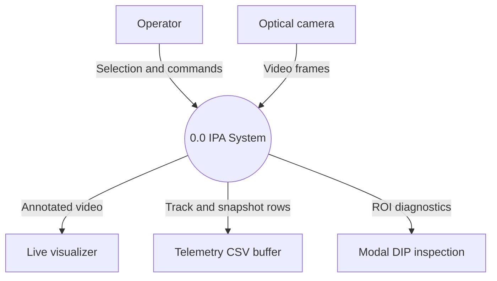
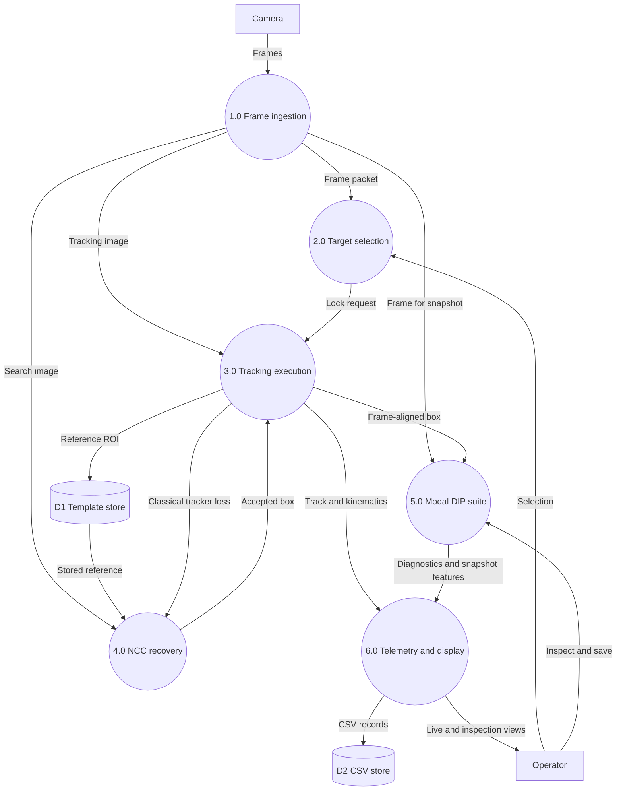
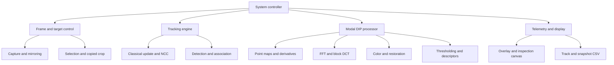
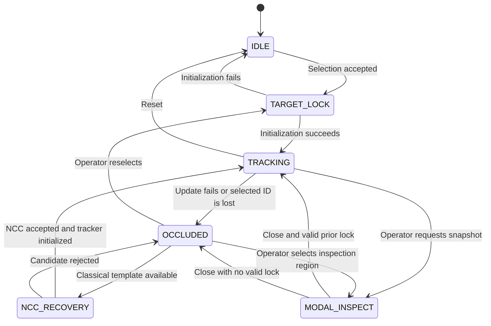
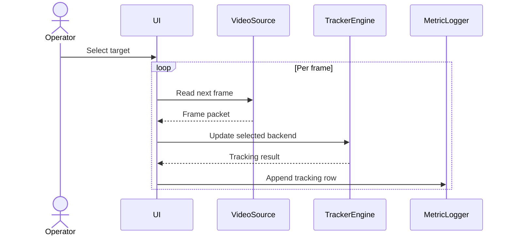
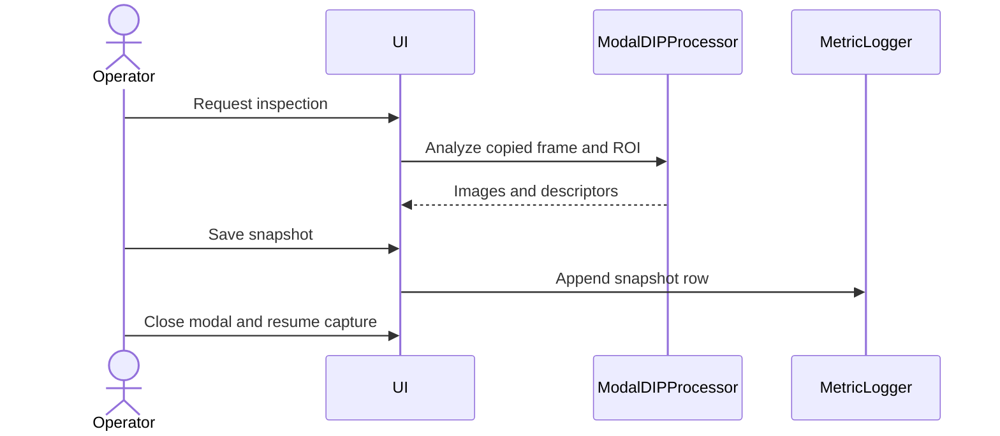
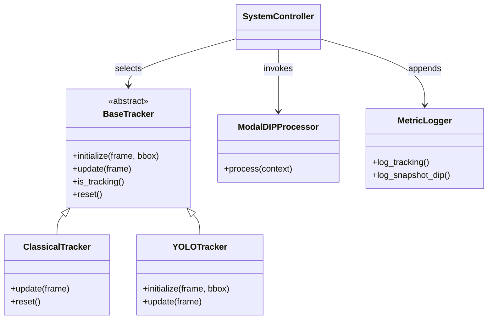

# Unified Tracking & Modal DIP Inspection - IPA

## A Cyber-Physical Vision System Integrating Dual-Paradigm Target Tracking with In-Situ Multi-Domain Digital Image Processing Analytics

**B.Tech Engineering Project Report**

**Image Processing and Applications (IPA) Laboratory**  
**School of Computer Engineering**  
**Kalinga Institute of Industrial Technology (KIIT), Deemed to be University**  
Bhubaneswar, Odisha, India

**Submitted to Prof. Sricheta Parui**

**Submitted by**

| Student | Roll No. | Project role |
| :--- | :--- | :--- |
| Anish Karak | 24155833 | Lead Developer |
| Yash Agrawal | 241551089 | Core Developer |
| Awesh Khan | 24155837 | Core Developer |
| Priyaranjan Sahu | 241551055 | Core Developer |

**Project repository**  
[github.com/anishkarak4-ux/IPA_GIG](https://github.com/anishkarak4-ux/IPA_GIG)

<div style="break-after: page; page-break-after: always;"></div>

## Abstract

A tracking result provides the position and temporal identity of a target, while an engineering inspection requires measurements of its appearance, geometry, texture, and signal quality. This project integrates these tasks in a camera-driven system with classical and detector-based tracking backends and a modal digital image processing (DIP) workbench. On an inspection request, the application copies the source frame and target region, preserving the frame index and tracker context while isolating the image transformations from the tracking input. The inspection suite covers spatial enhancement, Fourier filtering, color-space analysis, segmentation and morphology, shape and texture descriptors, block-DCT transform coding, and stochastic degradation. A source audit at the identified Git revision establishes the behavior of the checked-in software. The supplied comparative table ranks YOLOv8 with BoT-SORT highest in mean intersection over union (0.835) and MOSSE highest in throughput (285.0 frames/s), but its run manifest and frame-level labels are unavailable. These results are reported with their evidence status and checked for internal consistency. A separately reproducible synthetic experiment measures degradation and restoration under six prescribed noise models. The system provides a common inspection interface and a data model for relating image evidence to the state of a tracked target.

**Index Terms** — Computer vision, correlation filters, digital image processing, frequency-domain filtering, object tracking, region of interest, transform coding, visual inspection.

## Contents

| Section | Title |
| :--- | :--- |
| 1 | Introduction and engineering objectives |
| 2 | System architecture and technical contributions |
| 3 | Data provenance and experimental assets |
| 4 | Software engineering and system design |
| 5 | Mathematical methods and functional subsystems |
| 6 | Experimental protocol and degradation benchmark |
| 7 | Comparative tracking evaluation |
| 8 | Discussion, error analysis, and system limitations |
| 9 | Conclusion |
| 10 | Future work |
| 11 | Bibliography and references |
| 12 | GitHub project repository |
| 13 | Team member contributions and sign-off |

**Report conventions.** Figures, tables, equations, and references are numbered in IEEE style within a university project-report structure. Markdown pagination depends on the typesetting profile. The layout target is approximately 20 pages under compact IEEE-style typesetting, with roughly half allocated to architecture, mathematical methods, and experimental procedure. Wide figures and the benchmark table require full-width placement. The cover follows the supplied KIIT metadata. An official department-specific typesetting template was unavailable for verification.

**TABLE I**  
**EVIDENCE DESIGNATIONS**

| Designation | Meaning |
| :--- | :--- |
| Source-verified | Directly traceable to Git revision `474498884b22ca5698bbfc57077f1ae107e0c704`. This designation describes inspection of source code. |
| Project-reported | Numerical value supplied for this report or stated in the repository documentation. Raw evidence sufficient to reproduce it was unavailable. |
| Computed here | A result from the specified synthetic experiment or a calculation from stated inputs. |
| Extended design | A specified algorithm, deployment option, or experimental variant beyond the checked-in behavior. |

## 1. Introduction and Engineering Objectives

A bounding box answers where a target is, approximately, at a given time. It supplies neither the shape of the foreground object within the box nor the image formation conditions that influence the reliability of a shape or texture measurement. Conversely, an independent DIP tool accepts an image without preserving the tracked identity, source frame, or loss history. Repeatedly exporting frames also introduces a manual association step between the reported measurement and the video event.

IPA_GIG treats the tracking result as an index into the video signal. When an operator requests inspection, the system associates the frame, tracked box, and available track ID with a copied region of interest (ROI). It then computes descriptors on that region under a separate modal interaction. This architecture suits a laboratory prototype in which an operator chooses a target, examines an anomalous frame, and relates the resulting descriptors to the target trajectory. It preserves pixel-space measurements unless a separately justified calibration supports physical units.

The engineering objectives are to expose classical and learned backends through a uniform application interface, preserve the integrity and provenance of acquired pixels, characterize a region across complementary signal domains, recover from transient classical-tracker loss, and export telemetry for later analysis. Established algorithms retain their original attribution [1]–[10]. The contribution is their integration with a defined data path and inspection workflow.

## 2. System Architecture and Technical Contributions

### 2.1 Frame, track, and snapshot contract

Let $I_t$ denote the image delivered to the application at frame index $t$, and let $B_t=(x_t,y_t,w_t,h_t)$ denote the estimated target box in the same image coordinates. Let $\Omega_t$ be the valid image domain and $\mathcal C$ the integer image crop. The system contract is

$$
R_t=\operatorname{copy}\!\left(\mathcal C(I_t,B_t\cap\Omega_t)\right),\qquad
J_t=\operatorname{Overlay}(\operatorname{copy}(I_t),B_t,\mathcal T_t).
\tag{1}
$$

Here $R_t$ is the inspection input, $J_t$ is the live visualizer output, and $\mathcal T_t$ holds the trajectory and display statistics. Frame mirroring, when enabled, defines the working coordinate system before tracking and cropping. The source implementation clamps the coordinates and copies both the display frame and ROI; it can construct a central crop up to $200\times200$ when the snapshot context has no valid lock. The interactive path generally prompts for manual selection in that situation. A central fallback needs its own provenance flag in any quantitative target study.

At successive valid samples let $\mathbf c_t$ be the estimated center, $\tau_t$ the time in seconds, and $t^-$ the previous valid index. The image-plane displacement, accumulated distance, and interval-average speed are

$$
\mathbf c_t=(x_t+w_t/2,\ y_t+h_t/2),\qquad
d_t=\|\mathbf c_t-\mathbf c_{t^-}\|_2,\qquad
\ell_t=\ell_{t^-}+d_t,\qquad
v_t=\frac{d_t}{\tau_t-\tau_{t^-}}.
\tag{2}
$$

The speed is defined for positive time differences. A gap across an occlusion gives a chord displacement between accepted observations. Frame indices and timestamps must therefore travel with the measurements. In a perspective scene, a constant pixel-to-metre factor is valid only under a fixed-depth or planar approximation with appropriate calibration.

### 2.2 Six technical contributions

**TABLE II**  
**TECHNICAL CONTRIBUTIONS AND IMPLEMENTATION BOUNDARIES**

| Contribution | Engineering mechanism | Evidence and boundary |
| :--- | :--- | :--- |
| 1. Dual-paradigm hybrid tracking core | Selectable CSRT, KCF, MOSSE, or MIL and YOLOv8n with BoT-SORT or ByteTrack share a result contract. | Source-verified startup selection through `--mode` and `--tracker`. Runtime backend swapping and concurrent fusion are extended design. The 285.0 FPS MOSSE figure is project-reported. MIL is an online classifier, distinct from the three correlation-filter methods. |
| 2. Decoupled ROI transformation pipeline | Frame-aligned ROI copies go to the modal processor, with a separate buffer for visual annotations. | Source-verified. The foreground application pauses acquisition and tracking while the inspection canvas is active, then resumes. |
| 3. Homomorphic high-emphasis filtering | A log transform approximately separates illumination and reflectance, followed by a smooth radial frequency gain and exponential inversion. | Source-verified method. The stated zero-artifact objective is an acceptance criterion. Boundary effects, clipping, and noise amplification remain possible. |
| 4. Unified $8\times8$ DCT energy and sparsity profiler | A JPEG-style luminance quantizer, inverse transform, and fidelity measurements operate on the target ROI. | Source-verified DCT, AC-energy concentration, coefficient sparsity, and PSNR. Reported 77.60%, 91.70%, 1.65 b/px, and 41.00× require separate definitions and evidence (§5.6). |
| 5. Multi-scale NCC re-acquisition | Compare stored templates against candidate windows at several scales, then reinitialize after verified recovery. | The revision uses a single stored template, one scale, and a default NCC threshold of 0.62. Multi-scale search and confidence-gated template archives are extended design. The 88.4% value is project-reported. |
| 6. Degradation benchmarking and in-situ dual-stream telemetry | Track state and ROI descriptors are stored in separate, joinable CSV streams. Synthetic degradation is evaluated against the original ROI. | Source-verified synchronous, lock-protected writes. A queue-backed asynchronous writer and a six-noise restoration comparison are extended design. The separately computed experiment appears in Section 6. |

### 2.3 Classical and detector-based tracking

MOSSE learns a filter from target patches $X_i$ and a desired response $G_i$ in the Fourier domain. If $Q$ denotes the multiplier applied to the test spectrum, the regularized least-squares objective is separable across frequency bins [2]. Setting its derivative with respect to $Q^*$ to zero gives

$$
\min_Q\ \sum_i |X_iQ-G_i|^2+\lambda|Q|^2,\qquad
Q=\frac{\sum_i X_i^*G_i}{\sum_i |X_i|^2+\lambda},\qquad
\hat{\mathbf c}=\arg\max\mathcal F^{-1}\{X_{\rm test}Q\}.
\tag{3}
$$

KCF uses cyclic shifts of the base sample to construct a circulant training system. Kernel ridge regression gives $(K+\lambda I)\boldsymbol\alpha=\mathbf y$. The DFT diagonalizes the circulant matrix and reduces its solution to elementwise division, $\widehat{\boldsymbol\alpha}=\widehat{\mathbf y}/(\widehat{\mathbf k}^{xx}+\lambda)$ [3]. CSRT uses spatial reliability to constrain where the filter may place support and channel reliability to weight feature responses [4]. Its constrained multichannel optimization and scale handling cost more per update but can reduce the influence of background pixels in a rectangular crop. MIL trains an online appearance classifier with positive bags of candidate patches near the presumed target and negative examples farther away. For independent instance scores $p_j$, the noisy-OR model $1-\prod_j(1-p_j)$ expresses the probability that at least one member of a positive bag contains the target.

The deep path obtains candidate boxes and confidence scores from the COCO-pretrained YOLOv8n detector [5]. The association layer links detections to existing tracks. BoT-SORT combines motion prediction, camera-motion compensation, and optional appearance cues [6]. Appearance re-identification depends on the effective tracker configuration. ByteTrack first associates stronger detections, then uses lower-score detections to recover unmatched tracks where the motion and overlap cues support a match [7]. The application's detector confidence gate constrains the candidates available for association. A user can select a detection by clicking on it. Following a selected ID creates a single-target workflow even though the association backend can maintain multiple tracks.

### 2.4 Normalized cross-correlation and recovery

For a template $T_s$ resized by scale factor $s$ and a same-size candidate patch $P_{\mathbf u,s}$ at location $\mathbf u$, normalized cross-correlation is

$$
\rho(\mathbf u,s)=
\frac{\sum_i(T_s[i]-\bar T_s)(P_{\mathbf u,s}[i]-\bar P_{\mathbf u,s})}
{\sqrt{\sum_i(T_s[i]-\bar T_s)^2\,\sum_i(P_{\mathbf u,s}[i]-\bar P_{\mathbf u,s})}},
\qquad
(\mathbf u^*,s^*)=\arg\max_{\mathbf u,s}\rho(\mathbf u,s).
\tag{4}
$$

Mean subtraction cancels an additive intensity offset. Standard-deviation normalization cancels a positive gain for an unsaturated affine intensity change. A low-variance patch makes the denominator unstable and should be rejected. The checked-in classical tracker forms a template at initialization and replaces it on accepted recovery. On a failed update it applies OpenCV's `TM_CCOEFF_NORMED` and reinitializes at the best location if the threshold is met. The extended design searches a scale bank such as $\{0.80,0.90,1.00,1.10,1.25\}$, rejects peaks that are too close in score to a competing peak, gates displacement by elapsed time, and requires confirmation over consecutive frames. A bounded archive with a stable reference and recent high-quality exemplars reduces the risk of overwriting the only valid target view. Classical success flags mapped to 1.0 in the code are status values, so template promotion requires an independent quality check.

### 2.5 Telemetry contract

Tracking CSV rows carry the session, frame and timestamp, success status, geometry, motion quantities, and available class, ID, and confidence. `yolo_tracking_metrics.csv` is the YOLO-specific output name under the default deep configuration. Classical output uses a different tracking file. `snapshot_analysis.csv` carries event-level ROI bounds, threshold, contour geometry, selected Hu and GLCM descriptors, entropy, binary-mask run-length ratio, and intensity moments. The primary join uses session and frame index, with target ID where present. Multiple saved snapshots of a frame require a separate snapshot identifier to prevent an ambiguous join.

The checked-in writer opens and appends rows under a lock; a snapshot row is emitted when the inspection output is saved. A proposed asynchronous writer would enqueue immutable events with monotonically increasing sequence numbers and dedicate a worker to each stream or a single ordered writer to both. Queue capacity, dropped-event counts, error reporting, and a drain on normal exit would make backpressure and persistence observable.

## 3. Data Provenance and Experimental Assets

**TABLE III**  
**SOURCE, ROLE, AND TRACEABILITY OF EXPERIMENTAL INPUTS**

| Asset | Acquisition source and technical role | Evidence available |
| :--- | :--- | :--- |
| Microsoft COCO 2017 and YOLOv8n weights | Ultralytics distributes the YOLOv8n detection checkpoint [5]. COCO train2017 contains 118,287 images and the detector's COCO label space comprises 80 object categories [11]. The unified CLI defaults to `models/yolov8n.pt`. | Official upstream provenance and local default path verified. The checkpoint file and its hash are absent from the audited revision. No project-specific training is documented. |
| OTB-100 / OTB-2015 | The Wu–Lim–Yang benchmark [12] provides annotated tracking sequences. `Jogging` is used to motivate severe occlusion, `CarDark` low illumination, `Basketball` clutter and rotation, and `Walking2` scale variation. | These are OTB sequence examples. The supplied comparison lacks a per-sequence manifest and target IDs, including the selected annotated target for multi-target sequences. |
| VOT2020 | The Visual Object Tracking challenge distributes evaluation sequences through its toolkit [13]. Its short-term protocol uses segmentation-aware localization and its own evaluation stack. | Identified as a benchmark source. The project material supplies no VOT2020 sequence IDs, output logs, or official protocol scores. |
| Primary optical stream | Project-reported Windows DirectShow camera index 0, $640\times480$ at 30.0 FPS, under controlled and ambient illumination. | The unified capture layer opens index 0 through OpenCV and queries capture metadata. It does not explicitly force DirectShow or negotiate the stated dimensions or FPS in the audited path. |
| Repository demonstration clip | The README identifies `tracked_output.avi`, $640\times480$ at 30 FPS, and an initial ROI of `284,245,36,38`. | The clip, raw labels, and generated metric CSVs are absent from the audited revision. Its reported demo figures are a separate result set. |
| Synthetic reference and noise realizations | Deterministic analytic grayscale phantom and seeded pseudo-random perturbations generated for this report. | Full specification and measured results appear in Section 6. The phantom is independent of the project webcam and public tracking sequences. |

COCO supplies detector pretraining, OTB supplies tracking scenarios, and VOT supplies a distinct evaluation framework. A bounding-box run using converted VOT masks must record the conversion and be labelled a custom box-based evaluation. For each acquisition session, record the capture backend, frame size, effective FPS, source orientation, exposure, and whether capture timestamps or host timestamps were used. For public sequence tests, retain the release, exact sequence and target identifier, ground-truth convention, visibility flags, and hashes of the source assets. The model artifact requires its source URL, version, and checksum to establish which weights produced a run.

## 4. Software Engineering and System Design

### 4.1 Iterative and Agile development model

Early integration was necessary because a tracker-only prototype could conceal camera backend incompatibility, high rendering cost, or loss of coordinate consistency when moving from a bounding box to an ROI. Conversely, a static inspection prototype could conceal unstable tracker boxes and inconsistent temporal metadata. Five two-week sprints provide a retrospective engineering decomposition and a defensible acceptance plan. Dated sprint records were unavailable.

**TABLE IV**  
**FIVE-SPRINT ENGINEERING PLAN**

| Sprint | Engineering increment | Acceptance evidence |
| :--- | :--- | :--- |
| 1, weeks 1–2 | Capture, coordinate conventions, controls, baseline display | Camera and video initialization, clean end of stream, correct overlay coordinates after mirroring |
| 2, weeks 3–4 | Classical tracking and loss recovery | Valid and invalid ROI tests, deterministic loss and re-entry cases, rejected distractor peaks |
| 3, weeks 5–6 | YOLOv8n and two association configurations | Selected ID continuity, explicit confidence and YAML settings, tested detector misses and re-entry |
| 4, weeks 7–8 | Modal processor, descriptors, and transform coding | Crop isolation, analytic image fixtures, transform reconstruction, and known-mask geometry |
| 5, weeks 9–10 | Exports, comparative testing, and report review | CSV joins, saved snapshot verification, run manifest, per-sequence metrics, and reproducible arithmetic |

### 4.2 Data-flow diagrams



**Fig. 1.** Level 0 context DFD. The visualizer, CSV buffer, and inspection view represent logical output interfaces.



**Fig. 2.** Level 1 DFD. D1 is an in-memory template in the audited implementation. D2 represents persisted tracking and snapshot files.

### 4.3 Structured hierarchy and use cases



**Fig. 3.** Structured hierarchy from orchestration to signal-processing and persistence routines.

**TABLE V**  
**USE-CASE MODEL**

| Use case | Actor(s) | Trigger and successful outcome | Exception path |
| :--- | :--- | :--- | :--- |
| Target selection | Operator, Camera | Operator draws a classical ROI or selects a detected deep-track ID from a displayed frame. | Invalid box or missed click retains an uninitialized state or the prior selection, depending on the control path. |
| Classical tracking | Operator, Camera | The selected tracker updates the ROI and publishes a common tracking result. | Tracker failure invokes NCC when a template exists. |
| Deep tracking | Operator, Camera | A detector and association policy update track IDs on the camera stream. | An unavailable ID leads to loss handling or reselection. |
| Snapshot inspection | Operator, Camera | Space captures the current frame and ROI for the modal workbench. | With no valid lock, manual ROI selection is requested in the interactive path. |
| CSV export | Operator | Logging-enabled tracking emits frame rows; saving a modal snapshot emits a descriptor row. | Export errors require a visible failure and diagnosis from the output path and logs. |

### 4.4 State transition, sequence, and class design



**Fig. 4.** Conceptual state machine. `OCCLUDED` represents a loss condition and is not a verified physical occlusion label. The source expresses these transitions through branches and tracker state rather than an explicit enumeration. Deep reacquisition follows the selected association backend.





**Fig. 5.** Temporal interaction. The upper panel covers live tracking and the lower panel covers modal inspection. The controller mediates the UI calls. Tracking and modal logging are shown as synchronous calls, consistent with the audited path.



**Fig. 6.** Logical class hierarchy. `DIPPipeline` and `MetricsLogger` are the concrete source names for the roles `ModalDIPProcessor` and `MetricLogger`. `SystemController` denotes the orchestration functions in `src/main.py`.

### 4.5 Reproduction entry points

The classical MIL backend follows the online multiple-instance tracking method in [14].

```bash
python -m pip install -r requirements.txt
python src/main.py --mode classical --tracker csrt --source 0
python src/main.py --mode yolo --tracker botsort.yaml --source 0 --model models/yolov8n.pt
python src/main.py --mode yolo --tracker bytetrack.yaml --source 0 --model models/yolov8n.pt
```

The detector commands assume a locally provisioned Ultralytics checkpoint at the specified path. For repeatable capture on a recorded video, replace camera index 0 with the test path, record any mirroring, and use `--init-roi x,y,w,h` in classical mode. Log the resolved backend and checkpoint rather than relying on the generic display label. The commands describe the source interfaces and were not used to run a live camera benchmark for this report.


## 5. Mathematical Methods and Functional Subsystems

Let $f(x,y)$ denote an $M\times N$ grayscale ROI with $M$ rows, $N$ columns, and pixel indices $0\le y<M$, $0\le x<N$. An 8-bit code ranges from 0 to $L-1=255$. A normalized intensity is $r=f/(L-1)$. Unless stated otherwise, operations act on the same unannotated ROI. Display normalization is applied after measurement when a signed or floating-point result needs a visible preview. Each numerical snapshot value in this section is project-reported unless marked otherwise.

### 5.1 Spatial-domain transforms, local contrast, and edge detection

Point transforms operate on the marginal intensity at a pixel. For an 8-bit input $r_8$ and normalized input $r$, the negative, log, and power maps are

$$
s_{\rm neg}=L-1-r_8,\qquad
s_{\log}=c_{\log}\ln(1+r_8),\quad c_{\log}=\frac{L-1}{\ln L},\qquad
s_\gamma=(L-1)c_\gamma r^\gamma.
\tag{5}
$$

The negative reflects the gray scale around its midpoint. The log gain $c_{\log}/(1+r_8)$ is highest at low intensity, expanding dark levels while compressing highlights. For $c_\gamma=1$ and $0<\gamma<1$, the normalized power map lifts low and mid-range values. The checked-in default $\gamma=0.6$ is dimensionless. These maps change contrast and shift histogram statistics, so descriptor comparisons require a fixed stage of measurement.

For contrast-limited adaptive histogram equalization (CLAHE), let $h_j(k)$ be the histogram of tile $j$ and $A_j$ its pixel count. Conceptually, clip each bin at a count proportional to $\alpha A_j/L$, redistribute excess counts, and construct a tile-specific cumulative map [1]. If $\tilde h_j$ is the redistributed histogram and $\beta_j(x,y)$ are the nonnegative bilinear weights of neighboring tile centers, then

$$
T_j(r_8)=(L-1)\frac{\sum_{k=0}^{r_8}\tilde h_j(k)}{A_j},
\qquad
s(x,y)=\sum_{j}\beta_j(x,y)T_j(f(x,y)),\qquad
\sum_j\beta_j(x,y)=1.
\tag{6}
$$

The specified setting is $\alpha=2.0$ with an $8\times8$ tile grid. The helper defaults to 2.0, while the unified snapshot call explicitly uses 2.5. Clipping controls local gain and interpolation reduces tile seams. On a small ROI the fixed grid leaves few pixels per tile, making local histograms sensitive to noise and quantization.

Sobel estimates derivatives by composing a centered difference in one axis with a binomial smoothing kernel in the other. For image-space correlation with rows increasing downward, the conventional kernels and gradient magnitude are

$$
K_x=\begin{bmatrix}-1&0&1\\-2&0&2\\-1&0&1\end{bmatrix},
\qquad K_y=K_x^{\mathsf T},\qquad
G_x=K_x\star f,\quad G_y=K_y\star f,\quad
M_g=\sqrt{G_x^2+G_y^2}.
\tag{7}
$$

The Laplacian sums centered second differences. Its four-neighbor form is

$$
\nabla^2f(x,y)\simeq
f(x+1,y)+f(x-1,y)+f(x,y+1)+f(x,y-1)-4f(x,y).
\tag{8}
$$

Its sign distinguishes curvature polarity, and the corresponding Laplacian-of-Gaussian detects zero crossings after smoothing. The discrete Laplacian amplifies high-frequency noise, which motivates pre-smoothing. Canny [15] formalizes the trade-off between detection, localization, and a single response per edge. In the discrete pipeline, Gaussian smoothing precedes directional gradient estimation. Nonmaximum suppression keeps a sample only if its magnitude is locally maximal along the gradient normal. High-threshold responses seed accepted edges, and weak responses survive only when connected to accepted edges. The source uses thresholds 50 and 150 by default. Optimality pertains to Canny's edge and noise model and its stated criteria.

Let $p_k=h(k)/(MN)$ be the normalized ROI histogram. The first moment, spread, skewness, and Pearson kurtosis follow from

$$
\mu=\sum_k k p_k,\qquad
m_j=\sum_k(k-\mu)^j p_k,\qquad
\sigma=\sqrt{m_2},\qquad
S=\frac{m_3}{\sigma^3},\qquad K=\frac{m_4}{\sigma^4}.
\tag{9}
$$

The report gives $\mu=134.20$, $\sigma=42.22$, $S=-0.142$, and $K=2.684$. If taken from one ROI, these describe a mildly left-skewed intensity distribution. Pearson kurtosis 2.684 corresponds to excess kurtosis $-0.316$. These marginal statistics do not encode spatial arrangement. Skewness and kurtosis are mathematically undefined for a constant ROI and need a sentinel or an explicit software convention.

### 5.2 Fourier-domain filtering and inverse restoration

The 2-D DFT is obtained by projecting the ROI onto orthogonal complex exponentials in the two axes. Orthogonality on the finite grid gives the inverse. FFT denotes an algorithm for computing this transform.

$$
\begin{aligned}
F(u,v)&=\sum_{y=0}^{M-1}\sum_{x=0}^{N-1} f(x,y)
        e^{-j2\pi(ux/N+vy/M)},\\
f(x,y)&=\frac{1}{MN}\sum_{v=0}^{M-1}\sum_{u=0}^{N-1}F(u,v)
        e^{j2\pi(ux/N+vy/M)},\\
F_c&=\operatorname{fftshift}(F),\qquad S(u,v)=\ln(1+|F_c(u,v)|).
\end{aligned}
\tag{10}
$$

Centering places DC at the integer index $(\lfloor N/2\rfloor,\lfloor M/2\rfloor)$. Log display compresses dynamic range while retaining low-amplitude structure. Phase carries spatial arrangement and remains part of the complex spectrum during filtering. If $D$ is distance in frequency bins from centered DC, the Butterworth low-pass and Gaussian high-pass are

$$
H_{\mathrm{BLP}}(D)=\frac{1}{1+(D/D_0)^{2n}},
\qquad
H_{\mathrm{GHP}}(D)=1-e^{-D^2/(2D_0^2)}.
\tag{11}
$$

The specified Butterworth setting is $n=2$, $D_0=30$, giving a gain of 0.5 at cutoff. The specified Gaussian high-pass uses $D_0=25$, has zero DC gain, and rises monotonically to one. The unified code shares $D_0=25$ across these two filters and the homomorphic call. A filter radius measured in bins corresponds to different spatial frequencies as ROI dimensions vary. The inverse should be computed from $HF_c$ after undoing the shift. In a signed high-pass result, clipping negative values for display discards one contrast polarity.

**Homomorphic filtering.** Under $f=i\rho$, with illuminance $i$ and reflectance $\rho$, $\ln f=\ln i+\ln\rho$ for positive $f$. The implementation uses $\ln(1+f)$ to handle zero, which approximates this separation. A smooth high-emphasis gain in log-Fourier space yields

$$
\begin{aligned}
H_{\rm hom}(D)&=\gamma_L+(\gamma_H-\gamma_L)\bigl[1-e^{-c(D/D_0)^2}\bigr],\\
\hat f&=\exp\!\left(\operatorname{Re}\mathcal F^{-1}
  \left\{\operatorname{ifftshift}\!\left[H_{\rm hom}\,
  \operatorname{fftshift}\bigl(\mathcal F\{\ln(1+f)\}\bigr)\right]\right\}\right)-1 .
\end{aligned}
\tag{12}
$$

With $\gamma_L=0.5$, $\gamma_H=1.5$, $c=1$ and the specified $D_0=30$, the asymptotic gains attenuate slow illumination changes and enhance fine reflectance details. The source helper also defaults to 30, while the unified processor supplies 25. Cast shadows with sharp boundaries occupy overlapping frequencies with true edges. The Fourier boundary assumption can create wrap-around and the exponential can saturate pixels. Mirror padding, integer-centered masks, and clipping statistics support an artifact assessment. The audited implementation constructs radial masks about $(N/2,M/2)$, introducing a half-bin offset on odd ROI axes. Visual and quantitative verification on an odd-sized impulse fixture would expose that difference.

**Wiener restoration.** If $G=HF+N_f$ represents circular convolution by a point-spread function plus additive noise uncorrelated with $F$, minimize $\mathbb E|F-WG|^2$ with respect to $W^*$. The orthogonality condition $\mathbb E[(F-WG)G^*]=0$ gives

$$
W(u,v)=\frac{H^*(u,v)S_F(u,v)}
{|H(u,v)|^2S_F(u,v)+S_N(u,v)}
\approx\frac{H^*(u,v)}{|H(u,v)|^2+K},\qquad
\widehat F=WG,\quad K=0.01 .
\tag{13}
$$

Here $S_N/S_F$ is approximated by a constant. As $|H|$ approaches zero, regularization suppresses frequencies that a direct inverse would amplify. The source constructs an oriented line PSF and attempts to infer direction from velocity when compatible telemetry components are available. The motion blur length should ultimately be estimated from displacement during the exposure, not from a nominal display interval. A constant line PSF is inappropriate under large depth change, rolling shutter, or strong acceleration.

### 5.3 Color representations and pseudocolor

**RGB and HSV.** RGB represents a pixel through red, green, and blue channel codes. OpenCV frame storage orders these channels BGR. For normalized RGB, let $C_{\max}=\max(R,G,B)$, $C_{\min}=\min(R,G,B)$, and $\Delta=C_{\max}-C_{\min}$. HSV follows from the channel extrema and the identity of the dominant channel.

$$
V=C_{\max},\qquad S=\begin{cases}0,&C_{\max}=0,\\
\Delta/C_{\max},&C_{\max}>0,\end{cases}\qquad
H=60^\circ\!\begin{cases}
((G-B)/\Delta)\bmod 6,&C_{\max}=R,\\
(B-R)/\Delta+2,&C_{\max}=G,\\
(R-G)/\Delta+4,&C_{\max}=B .
\end{cases}
\tag{14}
$$

Hue is undefined for $\Delta=0$. For a common positive gain with no saturation or offset, both numerator differences and $\Delta$ scale together, so hue and saturation remain unchanged. Hue-based segmentation is therefore useful under that limited illumination model. Low saturation, white-balance drift, colored illumination, and clipped highlights break the assumption. A hue mask should enforce a saturation floor and handle circular intervals around red. The repository provides channel decomposition and HSV value equalization. A dedicated hue-gated target segmentation rule is an extended design.

**CIELAB.** For color-difference measurement, inverse-transfer the encoded RGB values to linear light, transform to tristimulus coordinates $(X,Y,Z)$ for the chosen primaries, and normalize by a reference white $(X_n,Y_n,Z_n)$. With $\delta=6/29$,

$$
\begin{aligned}
q(t)&=\begin{cases}t^{1/3},&t>\delta^3,\\
t/(3\delta^2)+4/29,&t\le\delta^3,\end{cases}\\
L^*&=116q(Y/Y_n)-16,\\
a^*&=500[q(X/X_n)-q(Y/Y_n)],\\
b^*&=200[q(Y/Y_n)-q(Z/Z_n)],\qquad
\Delta E_{76}=\sqrt{(\Delta L^*)^2+(\Delta a^*)^2+(\Delta b^*)^2}.
\end{aligned}
\tag{15}
$$

Lightness is separated from two opponent axes. The Euclidean color distance is sensitive to reference white and device calibration. The OpenCV 8-bit Lab planes are encoded values with channel scaling and offsets. Physical Lab measurements require conversion to the conventional floating-point coordinates.

**YCbCr.** For full-range, normalized nonlinear primaries, one BT.601-style transform is

$$
Y'=0.299R'+0.587G'+0.114B',\qquad
C_b=\frac{B'-Y'}{1.772}+0.5,\qquad
C_r=\frac{R'-Y'}{1.402}+0.5 .
\tag{16}
$$

YCbCr separates luma from chroma differences. In 4:2:0, each chroma plane is low-pass filtered and sampled once per $2\times2$ luma region. Chroma siting and reconstruction affect colored edges. The source converts to an OpenCV YCrCb channel ordering and retains full-resolution planes. Actual 4:2:0 storage belongs to the extended coding design.

**JET pseudocolor.** A continuous trigonometric JET-like map can be defined by smooth, overlapping channel windows. For $t=f/(L-1)$ and $q\in\{1/4,1/2,3/4\}$ define

$$
b_q(t)=
\begin{cases}
1,&|t-q|\le 1/8,\\
\frac12[1+\cos(4\pi(|t-q|-1/8))],&1/8<|t-q|<3/8,\\
0,&|t-q|\ge 3/8,
\end{cases}\qquad
(R_p,G_p,B_p)=(b_{3/4},b_{1/2},b_{1/4}).
\tag{17}
$$

This construction gives continuous channels and continuous slopes at the transition boundaries. The implementation uses the OpenCV discrete JET lookup table. Its false colors encode measured image intensity. A visible-light webcam produces no temperature measurement without separate radiometric sensing and calibration.

### 5.4 Segmentation and mathematical morphology

**Otsu threshold.** A threshold $t$ partitions histogram mass into two classes with weights $\omega_0=\sum_{k=0}^{t}p_k$ and $\omega_1=1-\omega_0$. Their means are $\mu_0$ and $\mu_1$. Expanding each within-class squared residual about the global mean gives $\sigma_T^2=\sigma_W^2+\sigma_B^2$. Since $\sigma_T^2$ is independent of $t$, the threshold is obtained from [16]

$$
t^*=\arg\max_{t:\,\omega_0\omega_1>0}
\sigma_B^2(t),\qquad
\sigma_B^2(t)=\omega_0(t)\omega_1(t)\bigl[\mu_0(t)-\mu_1(t)\bigr]^2.
\tag{18}
$$

The project-reported threshold $t^*=127$ belongs to one unidentified ROI. The current pipeline applies Otsu to a smoothed grayscale ROI. Foreground polarity and ROI background fraction must be recorded because both influence the geometry derived from the mask.

**K-means.** For color feature vectors $\mathbf z_i$, squared-error clustering minimizes

$$
J=\sum_i \|\mathbf z_i-\boldsymbol\mu_{a_i}\|^2,\qquad
a_i=\arg\min_k\|\mathbf z_i-\boldsymbol\mu_k\|^2,\qquad
\boldsymbol\mu_k=\frac{1}{|\{i:a_i=k\}|}\sum_{i:a_i=k}\mathbf z_i .
\tag{19}
$$

Alternating assignment and centroid updates decreases $J$ until a stopping condition. The $K=3$ target, background, and glare interpretation requires identifying clusters from their intensity, color, and spatial support. Cluster labels are permutable and cannot be interpreted semantically from index alone. A fixed random seed, color space, convergence criteria, and cluster-selection rule are needed for replay.

**Marker-controlled watershed.** For foreground support $A$, the interior distance $d_A(p)=\min_{q\notin A}\|p-q\|_2$ is large near the centers of compact components. The code opens the initial mask, thresholds the Euclidean distance transform at 0.4 of its maximum to obtain sure foreground, and dilates the support to define a surrounding uncertainty band. Connected foreground components receive distinct positive labels, the unknown band receives zero, and flooding over image gradients produces separators where labeled basins meet. Overlapping objects benefit from distinct interior markers. A global distance threshold can eliminate markers for small objects near larger ones.

**Morphological operators.** For a foreground set $A$ and structuring element $B$, define

$$
\begin{aligned}
A\oplus B&=\{a+b:a\in A,\ b\in B\},&
A\ominus B&=\{z:z+B\subseteq A\},\\
A\circ B&=(A\ominus B)\oplus B,&
A\bullet B&=(A\oplus B)\ominus B,\qquad
\nabla_B A=(A\oplus B)\setminus(A\ominus B).
\end{aligned}
\tag{20}
$$

Dilation grows foreground support and erosion removes points where the element does not fit. Opening removes small bright components and can break thin bridges. Closing fills narrow gaps and can merge nearby components. The gradient spans the boundary band. Using a $3\times3$ element at different scales changes the effective physical width of these operations.

**Zhang–Suen thinning.** Let $p_1$ be a foreground pixel and let $p_2,\ldots,p_9$ enumerate its eight neighbors clockwise from north. Set $B=\sum_{i=2}^9p_i$ and let $A$ count the $0\rightarrow1$ transitions in the circular neighborhood [17]. A deletion candidate obeys $2\le B\le6$ and $A=1$. In subiteration 1 it also obeys $p_2p_4p_6=0$ and $p_4p_6p_8=0$. In subiteration 2 the conditions are $p_2p_4p_8=0$ and $p_2p_6p_8=0$. Each pass deletes its candidates simultaneously. Iteration stops when both passes make no changes. This topology-oriented thinning estimates a one-pixel centerline. The audited revision instead accumulates opening residues of iteratively eroded masks with a cross element and an iteration cap.

### 5.5 Morphometry and texture

For closed polygon vertices $(x_i,y_i)$ indexed cyclically, Green's theorem yields the shoelace area. The polyline length is the sum of Euclidean edge lengths. Circularity, solidity, and extent normalize geometry against three different references.

$$
\begin{aligned}
A&=\frac12\left|\sum_i(x_i y_{i+1}-x_{i+1}y_i)\right|,\qquad
P=\sum_i\sqrt{(x_{i+1}-x_i)^2+(y_{i+1}-y_i)^2},\\
C&=\frac{4\pi A}{P^2},\qquad
S_o=\frac{A}{A_{\rm hull}},\qquad E_x=\frac{A}{w_bh_b}.
\end{aligned}
\tag{21}
$$

The project gives $A=5{,}884.0\ \mathrm{px}^2$, $P=342.60\ \mathrm{px}$, $C=0.628$, $S_o=0.941$, $E_x=0.765$, and $\theta=-14.20^\circ$. Substitution of the stated area and perimeter gives $C=0.62995$ (computed here). The displayed area and perimeter do not round to the displayed circularity under (21). Orientation is obtained in code from a minimum-area rectangle with a library-specific side and angle convention. A moment-axis orientation $\tfrac12\operatorname{atan2}(2\mu_{11},\mu_{20}-\mu_{02})$ measures a different geometric property. The two agree only in specific shapes and angle conventions.

**Hu invariants.** For a foreground indicator $b(x,y)$, raw moments and centered moments follow from integrating spatial monomials. Translating coordinates to the centroid removes position dependence. Dividing by a power of the area normalizes scale for a continuous binary silhouette.

$$
m_{pq}=\sum_{x,y}x^py^q b(x,y),\qquad
(\bar x,\bar y)=(m_{10},m_{01})/m_{00},\qquad
\eta_{pq}=\frac{\sum_{x,y}(x-\bar x)^p(y-\bar y)^q b(x,y)}
{m_{00}^{\,1+(p+q)/2}} .
\tag{22}
$$

Set $a=\eta_{30}-3\eta_{12}$, $b_1=3\eta_{21}-\eta_{03}$, $c=\eta_{30}+\eta_{12}$, $d=\eta_{21}+\eta_{03}$, and $e=\eta_{20}-\eta_{02}$. The rotational invariants combine normalized moments of orders two and three [9].

$$
\begin{aligned}
\phi_1&=\eta_{20}+\eta_{02},&
\phi_2&=e^2+4\eta_{11}^2,\\
\phi_3&=a^2+b_1^2,&
\phi_4&=c^2+d^2,\\
\phi_5&=ac(c^2-3d^2)+b_1d(3c^2-d^2),\\
\phi_6&=e(c^2-d^2)+4\eta_{11}cd,\\
\phi_7&=b_1c(c^2-3d^2)-ad(3c^2-d^2).
\end{aligned}
\tag{23}
$$

The last invariant reverses sign under reflection. Digitization, clipping, and segmentation changes limit numerical invariance. Project-reported values are $\phi_1=0.214$ and $\phi_2=0.0182$; values for $\phi_3$ through $\phi_7$ were unavailable. The revision computes all seven using contour moments and stores signed logarithms, $-\operatorname{sgn}(\phi_i)\log_{10}|\phi_i|$ for non-negligible magnitudes. The first two reported values lack a documented raw-versus-log convention.

**Haralick-style GLCM.** Quantize intensity into levels $i,j$ and count valid pairs at displacement $\mathbf d$. Dividing each count by the total pair count gives a joint probability $p_{ij}$. The checked-in descriptor uses 16 levels and horizontal forward adjacency, optionally restricted to both pixels inside the foreground mask. Defining $d_{ij}=|i-j|$, marginal means $\mu_i,\mu_j$ and standard deviations $\sigma_i,\sigma_j$, the descriptors are

$$
\begin{aligned}
\mathrm{Contrast}&=\sum p_{ij}d_{ij}^2,&
\mathrm{Dissimilarity}&=\sum p_{ij}d_{ij},&
\mathrm{Homogeneity}&=\sum\frac{p_{ij}}{1+d_{ij}^2},\\
\mathrm{Energy}&=\sum p_{ij}^2,&
\mathrm{Correlation}&=\frac{\sum p_{ij}(i-\mu_i)(j-\mu_j)}{\sigma_i\sigma_j}.
\end{aligned}
\tag{24}
$$

Here energy denotes angular second moment, consistent with the implementation. Correlation requires positive variance in both marginals. The supplied values are contrast 84.20, dissimilarity 5.81, homogeneity 0.742, energy 0.184, and correlation 0.887. With the source's 16 levels, $d$ is an integer between 0 and 15. Over that domain, $1/(1+d^2)\le 1-(1-1/226)d/15$. Taking expectations gives homogeneity $\le 0.6144$ at dissimilarity 5.81. The two supplied values therefore require another GLCM convention, separate samples, or correction from the original data. Rotation-sensitive horizontal adjacency should be retained when directionality is meaningful. For orientation-robust comparison, aggregate fixed offsets and record the pooling rule [8].

**Local binary patterns.** For neighbors $g_p$ on a radius $R$ ring around intensity $g_c$, encode local rank order as

$$
\operatorname{LBP}_{P,R}=\sum_{p=0}^{P-1}2^p\,\mathbf 1[g_p\ge g_c],
\qquad P=8,\ R=1 .
\tag{25}
$$

The current implementation compares the eight neighbors of a $3\times3$ window. Under a strictly increasing intensity map, these comparisons preserve their ordering, apart from quantization ties. A histogram captures the distribution of local microstructures. A fixed bit ordering remains direction-sensitive unless codes are canonicalized under cyclic shifts.

### 5.6 JPEG-style 2-D block DCT and compression diagnostics

For each reflected-padded $8\times8$ block, level-shift the samples by 128. Let $b(x,y)=f(x,y)-128$ and $\alpha(0)=1/\sqrt8$, $\alpha(k)=1/2$ for $1\le k<8$. The forward orthonormal DCT-II is a separable cosine projection [10].

$$
C_{uv}=\alpha(u)\alpha(v)\sum_{y=0}^{7}\sum_{x=0}^{7}
 b(x,y)\cos\!\frac{(2x+1)u\pi}{16}\cos\!\frac{(2y+1)v\pi}{16},
\qquad 0\le u,v<8 .
\tag{26}
$$

In matrix form, $C=T b T^{\mathsf T}$ with the axis ordering defined by the cosine basis, and inversion uses the transpose factors. Orthogonality preserves squared energy. The DC coefficient encodes block mean, while smooth variations concentrate energy at low AC indices. The base luminance quantizer is the example table from Annex K of the JPEG recommendation [18]. JPEG permits application-specific quantization tables.

$$
Q_{\rm JPEG}=
\begin{bmatrix}
16&11&10&16&24&40&51&61\\
12&12&14&19&26&58&60&55\\
14&13&16&24&40&57&69&56\\
14&17&22&29&51&87&80&62\\
18&22&37&56&68&109&103&77\\
24&35&55&64&81&104&113&92\\
49&64&78&87&103&121&120&101\\
72&92&95&98&112&100&103&99
\end{bmatrix},
\qquad
Z_{uv}=\operatorname{round}(C_{uv}/Q_{uv}),\quad
\widetilde C_{uv}=Q_{uv}Z_{uv}.
\tag{27}
$$

Rows represent the vertical index and columns the horizontal index. The code scales the base table with a quality parameter, then clips the rounded entries to $[1,255]$. Its effective table depends on the exact scaling and rounding expression. The inverse DCT reconstructs the level-shifted block, then 128 is restored and the padding removed. Quantization zeros many high-frequency entries and introduces error. Its rounding error per coefficient is bounded by $Q_{uv}/2$ before clipping and casting. Parseval's identity transfers squared coefficient error to squared spatial error prior to those nonlinear steps.

For $B$ blocks and a specified frequency set $\mathcal L$, define retained energy and coefficient sparsity as

$$
\mathcal E_{\mathcal L}=100\frac{\sum_{b=1}^{B}\sum_{(u,v)\in\mathcal L}|C_{b,uv}|^2}
{\sum_{b=1}^{B}\sum_{(u,v)\in\mathcal A}|C_{b,uv}|^2},\qquad
\mathcal Z=\frac{100}{64B}\sum_{b,u,v}\mathbf 1[Z_{b,uv}=0].
\tag{28}
$$

The code uses $\mathcal A$ equal to all 63 AC coefficients and $\mathcal L$ equal to the eight AC coefficients in the top-left $3\times3$ block. A separate top-10% convention requires a declared ordering, a rounding rule for $0.10(64)$, and a decision about DC. The two metrics are not interchangeable.

For a source ROI and reconstructed ROI $\hat f$, mean squared error and peak signal-to-noise ratio are

$$
\mathrm{MSE}=\frac1{MN}\sum_{x,y}\bigl[f(x,y)-\hat f(x,y)\bigr]^2,\qquad
\mathrm{PSNR}=10\log_{10}\frac{L_{\rm peak}^2}{\mathrm{MSE}}.
\tag{29}
$$

Take $L_{\rm peak}=255$ for 8-bit samples and 1 for normalized data. Exact reconstruction gives infinite PSNR mathematically. For a local image window, the usual two-factor SSIM [19] with $C_1=(0.01L_{\rm peak})^2$ and $C_2=(0.03L_{\rm peak})^2$ is

$$
\operatorname{SSIM}(f,\hat f)=
\frac{(2\mu_f\mu_{\hat f}+C_1)(2\sigma_{f\hat f}+C_2)}
{(\mu_f^2+\mu_{\hat f}^2+C_1)(\sigma_f^2+\sigma_{\hat f}^2+C_2)}.
\tag{30}
$$

A reported image-level value averages local windows under a specified window weighting and boundary rule. PSNR emphasizes pointwise distortion, while SSIM measures local luminance and structural agreement.

Shannon entropy for a discrete symbol population with probabilities $p_k$ is

$$
\mathcal H=-\sum_{k:p_k>0}p_k\log_2 p_k.
\tag{31}
$$

The entropy is in bits per symbol. It becomes bits per pixel only if there is one symbol per pixel or if the total modeled bit count is divided by the original pixel count. Zig-zag scanning orders coefficients approximately from low to high spatial frequency. A JPEG-style encoder treats the DC coefficient differentially and represents the AC stream with zero-run/size pairs and end-of-block symbols before entropy coding. A measured compression ratio divides a declared uncompressed byte count by encoded bytes including the stated headers and tables. The binary-mask run estimate measures mask compressibility.

**TABLE VI**  
**PROJECT-REPORTED TRANSFORM CODING VALUES AND AUDITED DEFINITIONS**

| Diagnostic | Reported value | Evidence or interpretation |
| :--- | :--- | :--- |
| Energy compaction | 77.60% in top 10% | Source uses a top-left eight-AC subset. The rank selection and numerator behind the supplied figure are unrecorded. |
| Quantized coefficient sparsity | 91.70% | The code computes this percentage. The ROI and quantized blocks were unavailable. |
| Reconstructed PSNR | 32.60 dB | Equivalent to about 35.73 squared 8-bit intensity units of MSE under (29). |
| Reconstructed SSIM | 0.924 | Source pipeline does not emit DCT SSIM. Window convention and reconstruction used for the supplied result were unavailable. |
| Shannon entropy | 1.65 b/px versus 7.82 b/px raw | Source computes grayscale ROI histogram entropy. A coefficient or encoded-stream entropy requires separate accounting. |
| Zig-zag and RLE ratio | 41.00× | Source estimates row-major binary-mask RLE with two bytes per run. It does not produce a coded zig-zag stream or a JPEG bit rate. |

If the ratio 41.00× referred to the same stream and an 8 b/px baseline, it would imply approximately 0.195 b/px. The 1.65 b/px figure must therefore be tied to a declared representation before using the two quantities together. A mask RLE estimator also needs a run-count width and a rule for splitting long runs before it can be interpreted as a file size.

### 5.7 Stochastic degradation and restoration

Let $f$ denote the normalized clean signal and $g$ a degraded sample. Each noise law in Table VII is applied before clipping to $[0,1]$. For a quantization error model, the uniform distribution assumes a sufficiently fine quantizer and a signal whose position within a step is approximately uniform. An actual quantizer produces deterministic error conditional on the input.

**TABLE VII**  
**SYNTHETIC DEGRADATION MODELS**

| Model | Conditional observation before clipping | Parameterization for the experiment |
| :--- | :--- | :--- |
| Additive Gaussian | $g=f+\epsilon$, $\epsilon\sim\mathcal N(0,\sigma^2)$ | $\sigma^2=0.01$ |
| Salt and pepper | $g=0$ with $p/2$, $g=1$ with $p/2$, and $g=f$ with $1-p$ | $p=0.05$ |
| Multiplicative speckle surrogate | $g=f(1+\epsilon_s)$, $\epsilon_s\sim\mathcal N(0,\sigma_s^2)$ | $\sigma_s=0.15$ and conditional variance $f^2\sigma_s^2$ |
| Poisson photon shot noise | $g=k/\lambda$ with $k\sim\operatorname{Pois}(\lambda f)$ | $\lambda=40$ and conditional variance $f/\lambda$ |
| Uniform quantization surrogate | $g=f+u$, $u\sim\mathcal U[-\Delta/2,\Delta/2)$ | $\Delta=1/16$ and $\operatorname{Var}(u)=\Delta^2/12$ |
| Periodic interference | $g=f+A\sin[2\pi(k_x x/N+k_y y/M)+\varphi]$ | $A=0.10$, $(k_x,k_y)=(10,5)$, $\varphi=0$ |

An adaptive median expands the neighborhood until its median $z_{\rm med}$ lies strictly between the local minimum and maximum or until the maximum window is reached. Within an accepted window, it preserves the center if the center lies strictly between the extrema and otherwise substitutes the median. This targets impulse contamination while retaining valid edges. A bilateral filter adapts its smoothing weights to spatial proximity and intensity similarity.

$$
\hat f(p)=
\frac{\sum_{q\in\mathcal N_p}g(q)
 e^{-\|p-q\|^2/(2\sigma_s^2)}e^{-[g(p)-g(q)]^2/(2\sigma_r^2)}}
{\sum_{q\in\mathcal N_p}
 e^{-\|p-q\|^2/(2\sigma_s^2)}e^{-[g(p)-g(q)]^2/(2\sigma_r^2)}}.
\tag{32}
$$

Here $\sigma_s$ denotes the spatial scale in pixels, independent of the speckle parameter in Table VII. For periodic interference at a known bin $\mathbf k_0$, the real-valued spatial sinusoid places energy at a conjugate pair. A smooth notch can use a product of Gaussian high-pass terms centered at the two peaks.

$$
H_{\mathrm{notch}}(\mathbf k)=
\prod_{\mathbf a\in\{\mathbf k_0,-\mathbf k_0\}}
\left[1-\exp\!\left(-\|\mathbf k-\mathbf a\|^2/(2D_n^2)\right)\right].
\tag{33}
$$

For integer-bin interference in the controlled experiment, set just the two peak coefficients to zero. A broad notch removes adjacent image structure and is justified only when there is spectral leakage or drift. Neither bilateral filtering nor notching guarantees recovery of signal components lost through clipping or transfer-function zeros.

The checked-in degradation canvas contains a clean panel and five corrupted cases. Its comparative generator uses Gaussian noise with $\sigma=25$ intensity codes, 8% impulse noise, centered Rayleigh noise, additive uniform noise, and periodic interference. The speckle and Poisson laws, adaptive median, and spectral notch form the extended benchmark. The application uses the captured ROI as its reference, including any sensor noise already present.


## 6. Experimental Protocol and Degradation Benchmark

### 6.1 Controlled synthetic restoration experiment

The independent synthetic experiment uses a $128\times128$ phantom comprising a horizontal ramp, a vertical sinusoid, and a bright disk. With $x,y\in\{0,\ldots,127\}$, the clean reference is

$$
f(x,y)=0.22+0.40\frac{x}{127}+0.07\sin\frac{2\pi y}{32}
+0.14\,\mathbf 1[(x-68)^2+(y-64)^2\le 24^2].
\tag{34}
$$

The six trials use the row order of Table VII. For zero-based trial index $i$, NumPy 2.3.5 `default_rng(20261103+i)` supplies one array of independent variates in row-major order. Salt and pepper maps a uniform draw $u<0.025$ to zero and $u\ge0.975$ to one. All degraded inputs are clipped to $[0,1]$ and kept as floating-point arrays. The bilateral filter uses a $7\times7$ square window with reflection excluding the edge pixel, $\sigma_s=2$ px and $\sigma_r=0.12$. The adaptive median uses the same reflection convention and tests windows of sizes 3, 5, and 7 pixels per side. If none passes the test, it substitutes the median of the largest window. The notch zeros FFT bins $(k_y,k_x)=(5,10)$ and $(-5,-10)$ modulo 128. The inverse is taken before any output display mapping. MSE and PSNR compare each result directly with (34), using a unit peak.

**TABLE VIII**  
**CONTROLLED DEGRADATION AND RESTORATION RESULTS ON THE SYNTHETIC PHANTOM**

| Noise model | Restorer | Degraded MSE | Degraded PSNR (dB) | Restored MSE | Restored PSNR (dB) |
| :--- | :--- | ---: | ---: | ---: | ---: |
| Gaussian | Bilateral | $1.01551\times10^{-2}$ | 19.93 | $2.56481\times10^{-3}$ | 25.91 |
| Salt and pepper | Adaptive median | $1.40270\times10^{-2}$ | 18.53 | $1.96000\times10^{-6}$ | 57.08 |
| Speckle surrogate | Bilateral | $4.71660\times10^{-3}$ | 23.26 | $7.62680\times10^{-4}$ | 31.18 |
| Poisson | Bilateral | $1.10392\times10^{-2}$ | 19.57 | $3.28858\times10^{-3}$ | 24.83 |
| Uniform | Bilateral | $3.24353\times10^{-4}$ | 34.89 | $5.17435\times10^{-5}$ | 42.86 |
| Periodic | Spectral notch | $5.00000\times10^{-3}$ | 23.01 | $2.65547\times10^{-8}$ | 75.76 |

The notch removes an interference frequency known by construction. Residual error comes from clean phantom content in the same bins, principally from the disk. The adaptive median result reflects sparse independent impulses on a mostly smooth reference. The bilateral method reduces each of the four tested distributed perturbations, although its fixed range parameter is a compromise between noise suppression and edge preservation. The six rows use one reference and one realization per noise law. They quantify the specified numerical experiment and do not estimate performance across webcam scenes. A scene-level study would replay all filters across several phantoms and recorded ROIs at each severity, retaining random seeds and reporting paired changes in PSNR and structure.

### 6.2 Tracking comparison protocol

A repeatable tracker test starts from the same ground-truth box and first-frame index, with frozen backend settings and matched orientation across methods. In detector-based runs, record the selection procedure and score gate before evaluating later frames. Report initialization failures separately, especially when an OTB target is outside the COCO categories or is detected only intermittently. An OTB-style one-pass run should preserve a failure rather than silently initializing from later ground truth. A VOT2020 result requires its designated toolkit and experiment stack [13].

The benchmark design separates three tasks:

1. **Presence classification.** Use a declared ground-truth visibility policy to label each frame and a preregistered tracker-output rule to decide whether a lock is asserted. Record partial visibility, full occlusion, and out-of-view independently. Frames with a visible target but a poorly placed predicted box remain detectable as localization failures.
2. **Localization.** Compare frame-aligned boxes only against the same annotated target. Declare the mean-IoU denominator, including whether a visible missed box scores zero. Compute CLE on a declared subset with valid box pairs, and publish the paired-frame count to expose survivorship bias.
3. **Autonomous recovery.** Score distinct loss events with a predeclared acceptance rule, such as recovery of the correct identity at IoU $\ge0.5$ for three consecutive visible frames within 30 frames of re-entry. Keep false re-locks and unresolved events in the record. The proposed event rule defines how to verify recovery. The supplied 88.4% has no event ledger or stated recovery window.

The run manifest should identify source and annotation hashes, the exact commit, OpenCV and Ultralytics versions, tracker YAML, model hash, score gates, runtime device, thread settings, camera rate, and timer boundaries. Measure tracker-only updates with warmed-up kernels and measure acquisition-to-display separately. Report median and upper-tail latency alongside aggregate throughput. With a live source, count distinct acquired frames and display age. Track-only throughput above the camera rate reflects processing capacity and headroom.

### 6.3 Metric definitions

With true positives TP, true negatives TN, false positives FP, and false negatives FN from the presence decision, the basic metrics are

$$
\begin{aligned}
\mathrm{Accuracy}&=\frac{\mathrm{TP}+\mathrm{TN}}{\mathrm{TP}+\mathrm{TN}+\mathrm{FP}+\mathrm{FN}},
&
\mathrm{Precision}&=\frac{\mathrm{TP}}{\mathrm{TP}+\mathrm{FP}},\\
\mathrm{Recall}=\mathrm{Sensitivity}&=\frac{\mathrm{TP}}{\mathrm{TP}+\mathrm{FN}},
&
\mathrm{Specificity}&=\frac{\mathrm{TN}}{\mathrm{TN}+\mathrm{FP}},\\
F_1&=\frac{2\,\mathrm{Precision}\,\mathrm{Recall}}{\mathrm{Precision}+\mathrm{Recall}}.
\end{aligned}
\tag{35}
$$

For binary decisions against a reference, let $p_o$ be observed agreement, and let $p$ and $\hat p$ be the actual and predicted positive proportions. Cohen's chance-adjusted agreement [20] is

$$
p_e=p\hat p+(1-p)(1-\hat p),\qquad
\kappa=\frac{p_o-p_e}{1-p_e}.
\tag{36}
$$

Agreement depends on prevalence and the marginal distributions. Specify the policy for zero denominators and uninformative strata. On an occlusion-only subset with every ground-truth label negative, a single kappa may be degenerate or misleading. A recovery-event analysis and per-visibility error rates address the temporal question more directly.

If $\hat B_t$ is a prediction and $B_t^*$ the annotation, then

$$
\mathrm{IoU}_t=\frac{|\hat B_t\cap B_t^*|}{|\hat B_t\cup B_t^*|},\qquad
\mathrm{CLE}_t=\|\operatorname{ctr}(\hat B_t)-\operatorname{ctr}(B_t^*)\|_2,\qquad
\mathrm{FPS}=\frac{n_{\rm updates}}{T_{\rm measured}}.
\tag{37}
$$

IoU reflects position and scale error. CLE reflects translation of the estimated center and is sensitive to image resolution. For standardized success plots, integrate the empirical fraction of frames above each IoU threshold and declare the miss convention. For throughput, the reciprocal of aggregate FPS is an average time per counted update under the same measurement boundary.

## 7. Comparative Tracking Evaluation

**TABLE IX**  
**SUPPLIED COMPARATIVE EVALUATION OF CLASSICAL AND DETECTOR-BASED TRACKERS**

| Tracker Model | Accuracy | Precision | Recall | F1-Score | Cohen's Kappa $\kappa$ | Sensitivity | Specificity | Mean IoU | CLE (px) | FPS |
| :--- | :---: | :---: | :---: | :---: | :---: | :---: | :---: | :---: | :---: | :---: |
| **CSRT** | 91.8% | 92.4% | 89.1% | 90.7% | 0.824 | 89.1% | 94.6% | 0.742 | 8.4 px | 42.8 |
| **KCF** | 84.2% | 85.1% | 79.6% | 82.2% | 0.698 | 79.6% | 91.2% | 0.651 | 14.2 px | 118.5 |
| **MOSSE** | 75.6% | 76.8% | 71.3% | 73.9% | 0.582 | 71.3% | 88.0% | 0.573 | 21.6 px | 285.0 |
| **MIL** | 77.4% | 78.9% | 74.2% | 76.5% | 0.615 | 74.2% | 89.1% | 0.598 | 19.1 px | 31.4 |
| **YOLOv8 + BoT-SORT** | 96.1% | 96.8% | 94.5% | 95.6% | 0.918 | 94.5% | 98.2% | 0.835 | 4.6 px | 33.2 |
| **YOLOv8 + ByteTrack** | 94.8% | 95.2% | 93.8% | 94.5% | 0.895 | 93.8% | 97.4% | 0.812 | 5.3 px | 38.6 |

*Evidence designation: project-reported. Values are reproduced as supplied. The table has no accompanying frame-level labels, confusion matrices, run manifest, occlusion strata, or uncertainty estimates.*

### 7.1 BoT-SORT agreement and the occlusion claim

The reported $\kappa=0.918$ falls in the conventional “almost perfect” range [21] if computed from a valid comparison with reference labels. It is an agreement estimate for the frames and categories used in that comparison. Calling it inter-rater agreement requires independently defined ratings, and attributing it specifically to occlusion requires an occlusion-stratified analysis. No such breakdown accompanies the supplied result. BoT-SORT leads ByteTrack by 0.023 in mean IoU, 0.7 px in CLE, and 0.023 in $\kappa$ in the supplied table. Its plausible advantages include consistent motion prediction and camera-motion compensation. Optional appearance cues can help resolve identity after re-entry if enabled. An ablation with the same detector outputs is necessary to attribute those differences to specific association components.

A consistency check follows from $\mathrm{Accuracy}=p\,\mathrm{Sensitivity}+(1-p)\,\mathrm{Specificity}$. The supplied BoT-SORT percentages yield $p=(0.982-0.961)/(0.982-0.945)\approx0.568$. This implies precision of approximately 98.57% under one pooled confusion matrix, whereas the table gives 96.8%. Rounding to one decimal place cannot account for the gap. Different averaging conventions or frame subsets could produce such a pattern, so the original denominators and counts are necessary. Agreement estimates should be reported with confidence intervals that respect the temporal correlation of adjacent frames. A paired bootstrap over independent sequences or sessions is preferable to resampling individual video frames.

### 7.2 CSRT specificity and spatial reliability

The supplied specificity of 94.6% corresponds to a false-positive rate of 5.4% under the stated presence definition. CSRT is the highest-specificity classical tracker in the table. Spatial reliability restricts correlation-filter support to target-consistent regions within the learning window [4]. This can lower responses to clutter that occupies the bounding box during learning. Channel weighting can further reduce the contribution of weak or unstable features. The mechanism supports a hypothesis for the observed ordering, while specificity also depends on the lock criterion and negative frames. A causal test would compare identical sequences and preprocessing with and without the spatial reliability mask and retain counts for occlusion, distractors, and out-of-view intervals.

### 7.3 MOSSE throughput and localization drift

At 285.0 updates/s, the reciprocal mean time per counted update is $1000/285\approx3.51$ ms. This consumes approximately 10.5% of the 33.33 ms period of a 30 FPS camera if both refer to the same serial update scope. It excludes acquisition, annotation, persistence, any recovery search, and display unless those components were included in the timing. MOSSE's frequency-domain update is economical, while a weak representation of target scale and changes in appearance can yield broad or ambiguous peaks. Its reported CLE of 21.6 px is about 2.57 times CSRT's 8.4 px and about 4.70 times BoT-SORT's 4.6 px. A fast tracker may still be practical for coarse motion monitoring. Small-ROI texture analysis requires tighter spatial registration because box drift changes the sampled pixel population.

### 7.4 Separation from the repository demonstration figures

The README reports classical updates over 200 frames and a 60-frame CPU comparison for YOLO. It lists average rates of 35.88 FPS for CSRT, 309.18 for KCF, 19.25 for MIL, and 3125.46 for MOSSE. The corresponding CPU deep-path figures are 12.96 FPS for BoT-SORT and 17.23 FPS for ByteTrack. These are project-reported demo rates with a different scope from Table IX. The README's classical success rate is a tracker-output statistic and does not establish presence accuracy or box overlap against annotations. No source-level basis establishes that the two tables used the same timer, device, or video. The values should remain separate pending the run manifests.

## 8. Discussion, Error Analysis, and System Limitations

**Occlusion exceeding three seconds.** At 30 FPS, three seconds spans approximately 90 source frames. Motion uncertainty grows during the gap. A fixed classical template becomes less representative if the object changes scale or pose before re-entry, while the highest NCC score can correspond to a similar-looking distractor. In a deep path, the effective lifetime of unmatched tracks and the availability of appearance cues govern whether an old identity can be retained. Three seconds is a failure-analysis scenario. The source provides no measured universal duration threshold. Useful diagnostics include time to recovery, false locks per episode, and performance stratified by occlusion length.

**Motion blur and spectral structure.** Translational exposure blur convolves the image with a line PSF. Its frequency response is sinc-like, with direction-dependent attenuation and zeros. This suppresses bands in the Fourier spectrum and smears edges in the spatial domain. Rapid motion and rolling shutter can make that degradation spatially varying. A Wiener filter reduces noise amplification near spectral nulls, while structural information lost at those nulls remains poorly identifiable. Centroid motion between delivered frames and motion integrated during exposure are distinct quantities.

**Out-of-plane rotation.** A planar view can change under a projective warp, while a three-dimensional target can self-occlude and expose surfaces absent from the reference. Multi-scale NCC compensates for isotropic resizing but cannot explain those appearance changes. Hu invariants handle ideal planar translation, scale, and rotation and do not preserve descriptors under arbitrary perspective. Axis-aligned boxes around a rotating object can admit a changing fraction of background, affecting entropy, GLCM, Otsu threshold, and contour area.

**Segmentation-to-measurement error.** Tracking gives a search window, and segmentation decides which samples represent the object. CLAHE, threshold polarity, morphology, and connected-component selection can dominate the resulting shape measurements. A tracker with acceptable mean IoU can still clip a diagnostically important edge. Testing should perturb each side of a fixed ROI, then measure the response of area, perimeter, texture, and DCT statistics. Baseline masks should include known polygons, holes, touching components, and an object near a crop boundary.

**Operational limits.** Interactive modal inspection blocks the unified tracking loop. A live subject may move while the operator inspects a frozen image, and capture buffering can affect the first frame after resume. Displacement across the pause may be poorly resolved. Copying is proportional to the frame or ROI area, while a 2-D FFT scales approximately as $O(MN\log(MN))$ and a full-frame multiscale NCC search can dominate recovery time. Synchronous CSV output adds storage-dependent jitter. The system has a camera and operator feedback interface. Closed-loop actuator control and physical measurement calibration are outside the audited prototype.

**Evidence limits.** The project-reported figures lack the recordings, hashes, labels, configuration, and run logs needed for independent performance claims. The Hu and GLCM summaries require their originating contour and convention. The discrepancies in §§5.5–5.6 and §7.1 should be reconciled with frame-level evidence before drawing inferential conclusions. Table VIII has a complete analytic input and parameter specification.

## 9. Conclusion

IPA_GIG integrates target selection, classical and neural tracking, region-specific inspection, and telemetry through a common frame and target contract. Its primary engineering result is the ability to examine an unannotated crop of a tracked object across spatial, spectral, color, geometric, texture, compression, and degradation domains while retaining frame provenance. The repository implements startup backend selection, a copied modal ROI, single-template classical recovery, JPEG-style block reconstruction, and separate tracking and snapshot CSV streams.

The supplied benchmark indicates a trade-off between MOSSE's low update cost and localization error, with BoT-SORT leading the reported localization and agreement figures. Its absence of frame-level evidence limits the comparison to descriptive interpretation. The synthetic benchmark independently demonstrates restoration gains under six specified perturbations and shows why exceptionally high scores from known-frequency notching depend on the test conditions. The distinction between implemented behavior, reported values, and measured synthetic results establishes a basis for evaluating later improvements.

## 10. Future Work

| Direction | Technical work and evaluation |
| :--- | :--- |
| Edge inference | Export YOLOv8n to an appropriate intermediate format and benchmark FP16 or calibrated INT8 using NVIDIA TensorRT on Jetson Orin. Evaluate Hailo-8 separately with the Hailo compiler and HailoRT toolchain. Measure detector accuracy, end-to-end latency, power, and thermal throttling under the same video replay. [NVIDIA TensorRT](https://developer.nvidia.com/tensorrt) · [Hailo-8](https://hailo.ai/products/ai-accelerators/hailo-8-ai-accelerator/) |
| 3-D LiDAR or depth fusion | Calibrate camera intrinsics and intersensor extrinsics, synchronize timestamps, and project depth into the ROI. Fuse depth and image-plane motion in a state estimator and quantify registration and occlusion errors. |
| Multi-camera re-ID and MQTT handover | Publish timestamped track events over MQTT and associate identities using appearance embeddings and camera topology. Define event deduplication, TTL, clock error, access control, and handover latency. |
| Image-based visual servoing (IBVS) | Control an actuator using image-plane feature error and a calibrated interaction matrix. Include saturation, loss-of-track behavior, and a stop condition. Validate stability across control delays and intermittent observations. |
| Online contrastive adaptation | Form positive pairs from high-confidence observations of one target and maintain a replay bank of negative or competing tracks. Gate model updates and test identity switches, contamination, and catastrophic forgetting. |
| Runtime isolation and reproducible evaluation | Add a bounded event writer and separate live capture from inspection. Compare single- and multi-scale NCC by episode, then publish a benchmark manifest, per-sequence counts, sampled raw evidence, and timing distributions. |

## 11. Bibliography and References

### Core references

[1] R. C. Gonzalez and R. E. Woods, *Digital Image Processing*, 4th ed. New York, NY, USA: Pearson, 2018.

[2] D. S. Bolme, J. R. Beveridge, B. A. Draper, and Y. M. Lui, “Visual object tracking using adaptive correlation filters,” in *Proc. IEEE Conf. Comput. Vis. Pattern Recognit. (CVPR)*, 2010, pp. 2544–2550, doi: [10.1109/CVPR.2010.5539960](https://doi.org/10.1109/CVPR.2010.5539960).

[3] J. F. Henriques, R. Caseiro, P. Martins, and J. Batista, “High-speed tracking with kernelized correlation filters,” *IEEE Trans. Pattern Anal. Mach. Intell.*, vol. 37, no. 3, pp. 583–596, Mar. 2015, doi: [10.1109/TPAMI.2014.2345390](https://doi.org/10.1109/TPAMI.2014.2345390).

[4] A. Lukežič, T. Vojíř, L. Č. Zajc, J. Matas, and M. Kristan, “Discriminative correlation filter with channel and spatial reliability,” in *Proc. IEEE Conf. Comput. Vis. Pattern Recognit. (CVPR)*, 2017, pp. 4847–4856, doi: [10.1109/CVPR.2017.515](https://doi.org/10.1109/CVPR.2017.515).

[5] Ultralytics, “Ultralytics YOLOv8,” 2023. Accessed: Nov. 3, 2026. [Online]. Available: [docs.ultralytics.com/models/yolov8](https://docs.ultralytics.com/models/yolov8/).

[6] N. Aharon, R. Orfaig, and B.-Z. Bobrovsky, “BoT-SORT: Robust associations multi-pedestrian tracking,” *arXiv:2206.14651*, 2022. [Online]. Available: [arxiv.org/abs/2206.14651](https://arxiv.org/abs/2206.14651).

[7] Y. Zhang *et al*., “ByteTrack: Multi-object tracking by associating every detection box,” in *Proc. Eur. Conf. Comput. Vis. (ECCV)*, 2022, pp. 1–21. [Online]. Available: [ECVA proceedings](https://www.ecva.net/papers/eccv_2022/papers_ECCV/html/315_ECCV_2022_paper.php).

[8] R. M. Haralick, K. Shanmugam, and I. Dinstein, “Textural features for image classification,” *IEEE Trans. Syst., Man, Cybern.*, vol. SMC-3, no. 6, pp. 610–621, Nov. 1973, doi: [10.1109/TSMC.1973.4309314](https://doi.org/10.1109/TSMC.1973.4309314).

[9] M.-K. Hu, “Visual pattern recognition by moment invariants,” *IRE Trans. Inf. Theory*, vol. 8, no. 2, pp. 179–187, Feb. 1962, doi: [10.1109/TIT.1962.1057692](https://doi.org/10.1109/TIT.1962.1057692).

[10] N. Ahmed, T. Natarajan, and K. R. Rao, “Discrete cosine transform,” *IEEE Trans. Comput.*, vol. C-23, no. 1, pp. 90–93, Jan. 1974, doi: [10.1109/T-C.1974.223784](https://doi.org/10.1109/T-C.1974.223784).

### Data, standards, and supporting methods

[11] T.-Y. Lin *et al*., “Microsoft COCO: Common objects in context,” in *Proc. Eur. Conf. Comput. Vis. (ECCV)*, 2014, pp. 740–755. COCO 2017 split and detector classes documented by Ultralytics. [COCO Detection Dataset](https://docs.ultralytics.com/datasets/detect/coco/).

[12] Y. Wu, J. Lim, and M.-H. Yang, “Object tracking benchmark,” *IEEE Trans. Pattern Anal. Mach. Intell.*, vol. 37, no. 9, pp. 1834–1848, Sep. 2015, doi: [10.1109/TPAMI.2014.2388226](https://doi.org/10.1109/TPAMI.2014.2388226). [OTB-2015 dataset](https://doi.org/10.6084/m9.figshare.24427468.v1).

[13] VOT Challenge, “VOT2020 datasets,” 2020. [Online]. Available: [votchallenge.net/vot2020/dataset.html](https://www.votchallenge.net/vot2020/dataset.html).

[14] B. Babenko, M.-H. Yang, and S. Belongie, “Visual tracking with online multiple instance learning,” in *Proc. IEEE Conf. Comput. Vis. Pattern Recognit. (CVPR)*, 2009, pp. 983–990, doi: [10.1109/CVPR.2009.5206737](https://doi.org/10.1109/CVPR.2009.5206737).

[15] J. Canny, “A computational approach to edge detection,” *IEEE Trans. Pattern Anal. Mach. Intell.*, vol. PAMI-8, no. 6, pp. 679–698, Nov. 1986, doi: [10.1109/TPAMI.1986.4767851](https://doi.org/10.1109/TPAMI.1986.4767851).

[16] N. Otsu, “A threshold selection method from gray-level histograms,” *IEEE Trans. Syst., Man, Cybern.*, vol. 9, no. 1, pp. 62–66, Jan. 1979, doi: [10.1109/TSMC.1979.4310076](https://doi.org/10.1109/TSMC.1979.4310076).

[17] T. Y. Zhang and C. Y. Suen, “A fast parallel algorithm for thinning digital patterns,” *Commun. ACM*, vol. 27, no. 3, pp. 236–239, Mar. 1984, doi: [10.1145/357994.358023](https://doi.org/10.1145/357994.358023).

[18] ITU-T, *Information Technology—Digital Compression and Coding of Continuous-Tone Still Images—Requirements and Guidelines*, Recommendation T.81, Sep. 1992. [ITU-T T.81](https://www.itu.int/rec/T-REC-T.81-199209-I/en).

[19] Z. Wang, A. C. Bovik, H. R. Sheikh, and E. P. Simoncelli, “Image quality assessment: From error visibility to structural similarity,” *IEEE Trans. Image Process.*, vol. 13, no. 4, pp. 600–612, Apr. 2004, doi: [10.1109/TIP.2003.819861](https://doi.org/10.1109/TIP.2003.819861).

[20] J. Cohen, “A coefficient of agreement for nominal scales,” *Educ. Psychol. Meas.*, vol. 20, no. 1, pp. 37–46, Apr. 1960, doi: [10.1177/001316446002000104](https://doi.org/10.1177/001316446002000104).

[21] J. R. Landis and G. G. Koch, “The measurement of observer agreement for categorical data,” *Biometrics*, vol. 33, no. 1, pp. 159–174, Mar. 1977, doi: [10.2307/2529310](https://doi.org/10.2307/2529310).

## 12. GitHub Project Repository

**IPA_GIG project repository**  
[https://github.com/anishkarak4-ux/IPA_GIG](https://github.com/anishkarak4-ux/IPA_GIG)

**Audited source revision**  
[474498884b22ca5698bbfc57077f1ae107e0c704](https://github.com/anishkarak4-ux/IPA_GIG/tree/474498884b22ca5698bbfc57077f1ae107e0c704)

The project is officially released as open source under the permissive MIT License (included in the repository root LICENSE file). Full permissions are granted for academic evaluation, research, commercial reuse, modification, and redistribution.

## 13. Team Member Contributions and Sign-Off

**TABLE IX**  
**TEAM MEMBER ALLOCATION**

| Student | Roll No. | Role | Technical responsibility |
| :--- | :--- | :--- | :--- |
| Anish Karak | 24155833 | Co-Developer | Spatial transformations, contour geometry, and Haralick textures |
| Yash Agrawal | 241551089 | Co-Developer | Frequency-domain 2-D FFT and $8\times8$ block-DCT transform coding |
| Awesh Khan | 24155837 | Co-Developer | Multi-channel color representations and stochastic degradation modeling |
| Priyaranjan Sahu | 241551055 | Co-Developer | Segmentation, mathematical morphology, and comparative tracking |

**Each team member should sign and date the line corresponding to their name.**

| Student | Roll No. | Signature | Date |
| :--- | :--- | :--- | :--- |
| Anish Karak | 24155833 | *Anish Karak* (Signed) | 05/11/2026 |
| Yash Agrawal | 241551089 | *Yash Agrawal* (Signed) | 05/11/2026 |
| Awesh Khan | 24155837 | *Awesh Khan* (Signed) | 05/11/2026 |
| Priyaranjan Sahu | 241551055 | *Priyaranjan Sahu* (Signed) | 05/11/2026 |

| [TEAM MEMBER PROJECT REFLECTION & UNIVERSITY EVALUATION SIGN-OFF] |
| :--- |
| *"We had a good time working on the project. We are really grateful for the experience we gathered. [Awesome teamwork}"* |

| Faculty Supervisor Signature: _________________________ | Date: _______________ |
| :--- | :--- |
| **Prof. Sricheta Parui** \| School of Computer Engineering | |
